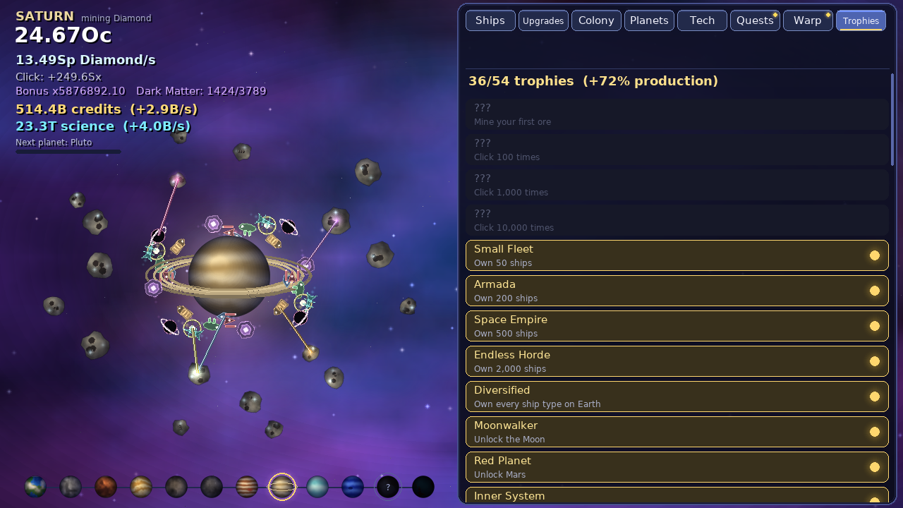

# Space Miner

An idle game for Linux, written in Python with [pygame](https://www.pygame.org). Start on Earth, mine the asteroids orbiting it, and expand across the whole solar system - and beyond. Every planet has its own ore, its own fleet, its own colony and its own bonus.


- **No assets, no dependencies except pygame** - every planet, ship, asteroid and effect is drawn by code at start-up.
- **Idle-friendly** - your fleets keep mining while the game is closed (up to 8 hours), and it autosaves every 15 seconds.
- **A lot of content** - 12 planets, 8 ship types per planet, 58 upgrades per planet, 6 colony buildings per planet, 12 megaprojects, 30 techs, 22 Dark Matter perks, 9 kinds of random events, rotating quests and 54 trophies.

## Quick start

```sh
git clone https://github.com/notyourbusinessss/PasstimeLinuxGame.git
cd PasstimeLinuxGame
./play.sh
```

`play.sh` installs pygame if it is missing and starts the game. You need Python 3.9+ and a desktop session.
Prefer to do it by hand?

```sh
pip install pygame
python3 space_miner.py
```

On distros where pip refuses to install into the system Python ("externally managed environment"), use a virtual environment:

```sh
python3 -m venv venv
./venv/bin/pip install pygame
./venv/bin/python space_miner.py
```

Missing Python or pip? Debian/Ubuntu: `sudo apt install python3 python3-pip python3-venv` - Fedora: `sudo dnf install python3 python3-pip` - Arch: `sudo pacman -S python python-pip`.

## Controls

| Input | Action |
|---|---|
| Click an asteroid / **SPACE** | Mine ore |
| Click the planets along the bottom | Travel to an unlocked planet (or open the Planets tab for a locked one) |
| **1** - **8** | Switch panel tab (Ships, Upgrades, Colony, Planets, Tech, Quests, Warp, Trophies) |
| Mouse wheel over the panel | Scroll the list |
| Click a golden supply crate | Grab it before it drifts off |
| **Esc** | Quit (the game saves on exit) |

Your save lives in `~/.space_miner_save.json`. Delete it (or use *Trophies -> Hard reset*) to start over.

## How the game works

### 1. Mine the asteroids

The planet you are visiting sits in the middle of the screen with asteroids orbiting it. Each click mines ore, shown in that planet's own ore type. Buy **ships** and they circle the planet, laser the asteroids and mine for you. Ships cost the same ore they mine, and each one gets pricier (+15%) than the last.


There are 8 ship types, from the humble Mining Drone to the Black Hole Engine. A new ship type shows up as `???` once you own the one before it.

| Ship | Base cost | Base ore/sec |
|---|---|---|
| Mining Drone | 15 | 0.10 |
| Laser Rig | 100 | 1 |
| Mining Barge | 1.1K | 8 |
| Refinery Ship | 12.0K | 47 |
| Orbital Foundry | 130.0K | 260 |
| Dyson Swarm | 1.4M | 1.4K |
| Neutron Tap | 20.0M | 7.8K |
| Black Hole Engine | 330.0M | 44.0K |

*(Costs and output are multiplied by 10 for every planet further out, so the first drone on the Moon costs 150 Silicon and mines 1 Silicon/sec, and on Mars 1.5K Copper and 10 Copper/sec.)*

### 2. Upgrades

The **Upgrades** tab lists what you can buy on the current planet with its ore: ship multipliers that unlock as you own more of a ship (x2, x2, x3, x3, x5), stronger clicks, drills that make each click also mine a share of your ore/sec, and *Star Charts* that boost the whole planet. **Buy everything affordable** is one click.


### 3. Unlock and travel to new planets

Open the **Planets** tab. The next planet is unlocked by paying ore from the worlds *behind* it - usually the previous planet's ore, plus a little of the one before that, plus credits later on. Unlocking gives you:

1. a **new ore** to mine on its own asteroids,
2. an empty **fleet, upgrade shop and colony** to build,
3. a permanent **planet bonus** that helps everywhere (clicks, cheaper ships, production multipliers, offline progress...).

Once a planet is unlocked, click it in the bottom strip (or the Planets tab) to fly there. A short hyperspace jump later you are mining a new ore. **Every unlocked planet keeps producing while you are somewhere else.**


| # | Planet | Ore | Planet bonus |
|---|---|---|---|
| 1 | Earth | Iron | Home world - where it all begins |
| 2 | Moon | Silicon | Low-gravity rigs: clicks x2 |
| 3 | Mars | Copper | Martian foundries: ships 5% cheaper everywhere |
| 4 | Venus | Silver | Trade winds: credit income x1.5 |
| 5 | Mercury | Gold | Solar farms: all ore production x1.5 |
| 6 | Ceres | Platinum | Belt beacons: crates 25% more often, pay x2 |
| 7 | Jupiter | Helium-3 | Gas-giant labs: science income x2 |
| 8 | Saturn | Diamond | Ring-miners: ships 5% cheaper, clicks x2 |
| 9 | Uranus | Antimatter | Cold engines: all ore production x2 |
| 10 | Neptune | Dark Crystal | Deep-space drift: offline progress at 75% |
| 11 | Pluto | Exotic Matter | Edge of the system: Dark Matter gain x1.5 |
| 12 | Proxima b | Quantum Foam | Another star: all ore production x3, buildings x1.5 |

A "Next planet" progress bar in the top-left corner shows how close you are, and hovering a planet in the bottom strip lists exactly what it costs.


### 4. Colonies and megaprojects

The **Colony** tab lets you build on the current planet. Credits and Science, which you need for techs and megaprojects, come from here.

| Building | Paid in | What it does |
|---|---|---|
| Mining Complex | that planet's ore | +3% ore output here / level |
| Habitat Dome | that planet's ore | Produces Credits |
| Research Lab | that planet's ore | Produces Science |
| Shipyard | credits | -0.6% ship prices here / level |
| Fusion Reactor | credits | +2.5% ALL production / level |
| Defense Grid | science | +4% supply crate frequency / level |

Each planet gives a x2 boost to one building type (Proxima b boosts all of them x1.5), and buildings go up to level 50.

Every planet also has one **megaproject** at the bottom of its Colony tab. It costs a huge pile of that planet's ore *plus* credits and science, and it permanently boosts your whole empire - even through Warps. That is what makes the old ores worth keeping.


| Planet | Megaproject | Effect |
|---|---|---|
| Earth | Orbital Ring | Ships 10% cheaper everywhere |
| Moon | Lunar Mass Driver | All production x1.5 |
| Mars | Terraformers | All production x2 |
| Venus | Cloud Cities | Credit income x3 |
| Mercury | Solar Array | All production x2 |
| Ceres | Belt Network | Crates 50% more often, pay x2 |
| Jupiter | Gas Siphons | Science income x3 |
| Saturn | Ring Elevator | All production x2 |
| Uranus | Ice Forges | Ships 10% cheaper everywhere |
| Neptune | Deep Core Mine | All production x3 |
| Pluto | Edge Gate | Dark Matter gain x2 |
| Proxima b | Alpha Dyson Swarm | All production x5 |

### 5. Tech tree

Science buys the **Tech** tree: 30 techs with prerequisites. They include automatic ship buying and upgrade buying (they only ever spend up to 25% of a stockpile so you can still save for planets), automatic crate collection, big production multipliers, cheaper ships, head-start ore after a Warp and more. Techs stay forever.


### 6. Quests, crates and random events

- **Quests** - three rotating goals (click asteroids, buy ships, mine ore, grab crates, upgrade colonies, resolve events...). Fill the bar and claim ore, credits, science or a Mining Frenzy.
- **Supply crates** - a golden crate drifts across the screen every minute or so. Grab it for ore, credits or a x7 *Mining Frenzy*.
- **Random events** - every few minutes something happens at the planet you are on: meteor showers, pirate raids, solar flares, a cosmic lottery, derelict ships, alien traders, research grants, distress signals and, very rarely, a whisper from the void. Most give you a risky option and a safe one.


### 7. Warp (prestige)

When progress slows down, open the **Warp** tab. Warping resets the ore, ships and upgrades on every planet, but you keep your unlocked planets, colonies, megaprojects, techs, credits, science and **Dark Matter**.

- Dark Matter total = (lifetime ore / 1 billion) ^ 0.25, so you earn it from everything you mine, not just one run.
- Your Dark Matter gives a permanent production bonus of `1 + 0.4 x sqrt(Dark Matter)`.
- You can also *spend* Dark Matter on 22 perks (all production x2, x3 or more, offline progress at 100%, faster travel, bigger starting supplies...).


A good rule of thumb: warp when the "Warp now for" number is at least as big as the Dark Matter you already own.

### 8. Trophies

There are 54 trophies (unlock planets, own ships, build colonies, research techs, grab crates, warp...). Every trophy adds +2% production.



## Late game

Later on you will be juggling a dozen planets, each with its own ore and fleet. This is what the endgame looks like on Saturn:


### Pacing

The pacing was tuned with a bot that plays the game headless (see below). A player who checks in every few minutes should reach roughly:

| Milestone | Roughly after |
|---|---|
| Moon | 12 minutes |
| Mars | 45 minutes |
| Venus | 1.5 - 3 hours |
| Mercury | 3 - 8 hours |
| Ceres / Jupiter | 5 - 17 hours |
| Saturn / Uranus | 15 - 33 hours |
| Neptune / Pluto | 25 - 55 hours |
| Proxima b | 45 - 70 hours |
| Every megaproject built | 50 - 100 hours |

Warping a few times along the way speeds this up a lot. Playing less often just means the numbers go up while you are away.

## Tips

- Early on, click a lot - clicks are strong until your first few ships. Buy a Habitat Dome and a Research Lab on Earth as soon as you can afford them: Credits and Science unlock the tech tree.
- Don't spend everything. Unlocking the next planet needs a big stockpile of the previous planet's ore, so stop buying ships on it once the progress bar is close.
- Visit new planets right after unlocking them: clicking there bootstraps a fleet quickly, and each planet bonus helps every other planet.
- Research *Auto-Drones* and *Auto-Engineers* early and the game mostly plays itself while you travel.
- If a dot is glowing on a tab, there is something affordable in it.

## Project layout

| File | What it is |
|---|---|
| `space_miner.py` | The game window, input and all the UI |
| `core.py` | Game rules and state. No pygame in here, so it runs headless |
| `gfx.py` | Procedural graphics: planets, asteroids, ships, backdrops |
| `sim.py` | A greedy bot that plays the game headless and prints a pacing timeline |
| `calibrate.py` | Searches for planet / megaproject prices that hit a target timeline using the bot |
| `play.sh` | Launcher that installs pygame if needed |
| `screenshots/` | Images used in this README |

### Balancing tools

```sh
python3 sim.py hours=100 interval=120        # bot checks in every 2 minutes for 100 simulated hours
python3 sim.py hours=100 interval=900 quiet=1 # only print unlocks and megaprojects
python3 calibrate.py interval=120             # re-derive unlock/project prices (takes a while)
```

The knobs live in `core.py` (`UNLOCK_LOG`, `PROJECT_LOG`, `TUNE`).

### Self-test

`python3 space_miner.py --selftest` runs the game headless for a few seconds and exercises buying, unlocking, travelling, events, quests, warping and saving. It writes a few `shot_*.png` images next to the script.

## Troubleshooting

- **`ModuleNotFoundError: No module named 'pygame'`** - run `pip install pygame` (or use `./play.sh`).
- **No window appears over SSH / in a container** - the game needs a display. Run it from a desktop session.
- **Text looks off** - the game asks for DejaVu Sans, Liberation Sans or Arial and falls back to pygame's default font.
- **Reset everything** - delete `~/.space_miner_save.json`.

