# Space Miner

An idle game for Linux, written in Python with [pygame](https://www.pygame.org). Start on Earth, mine the asteroids orbiting it, and expand across the whole solar system - and beyond. Every planet has its own ore, its own fleet, its own colony and its own bonus.


- **No assets, no dependencies except pygame** - every planet, ship, asteroid and effect is drawn by code at start-up.
- **Idle-friendly** - your fleets keep mining while the game is closed (up to 8 hours), and it autosaves every 15 seconds.
- **A lot of content** - 12 planets in the solar system and **every world of every star you liberate (about 15,900 of them) to settle and play**, 10 ship classes per planet, 68 upgrades per planet, 6 colony buildings per planet, 12 megaprojects, 32 techs, 22 Dark Matter perks, 9 kinds of random events, rotating quests, **the real Milky Way to conquer, with more than 6,000 star systems**, **New Game+ with Stardust** and **200 achievements**. Sound effects are generated by code too, and there is a developer mode for testing.

## Download

Grab the latest build from the [Releases page](https://github.com/notyourbusinessss/PasstimeLinuxGame/releases/latest).

**Linux** (`space-miner-<version>-linux-x86_64.tar.gz`) - a single executable, no Python or pygame needed:

```sh
tar -xzf space-miner-*-linux-x86_64.tar.gz
cd space-miner-*-linux-x86_64
./space-miner                 # just run it, or...
./install.sh                  # ...add it to your applications menu (no root; ./install.sh --uninstall removes it)
```

The build needs a reasonably recent distro (glibc 2.35 or newer, e.g. Ubuntu 22.04+). On an older one, run it from source (below).

## Android

Space Miner also runs on Android phones and tablets (landscape).

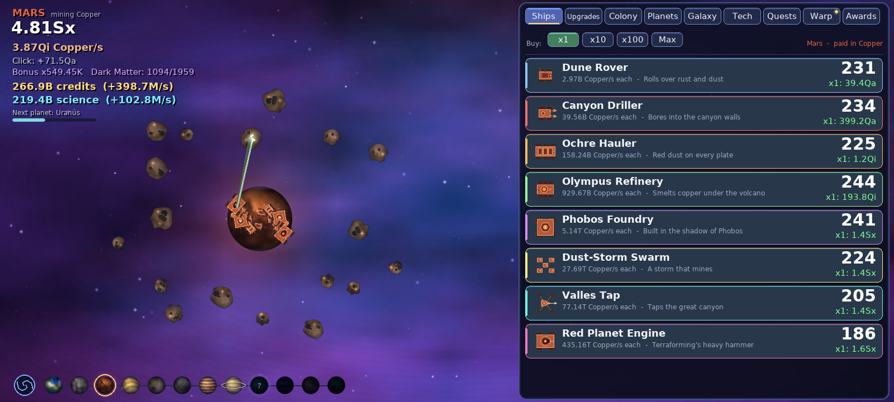

**Install.** Download `space-miner-<version>-android.apk` from the [Releases page](https://github.com/notyourbusinessss/PasstimeLinuxGame/releases/latest), open it on the device and allow installing apps from this source when Android asks (the APK is debug-signed, so it is for sideloading, not the Play Store). Your save is private to the app.

**How it plays.** The whole game works with touch:

| Gesture | Action |
|---|---|
| Tap the planet view | Mine the nearest asteroid (tap anywhere; use several fingers at once) |
| Tap a button or a row | Press it (a tap that moves is a scroll, so you never buy by accident) |
| Drag a list up or down | Scroll it; let go while moving to fling it |
| Drag the galaxy map | Pan |
| Pinch the galaxy map | Zoom (two fingers also pan) |
| Double-tap a system | Close look at it |
| Back button | Leave the galaxy map (it never quits the game) |
| Home / switching apps | The game saves; when you come back it pays the progress you missed (up to 8 hours, like when the game is closed) |

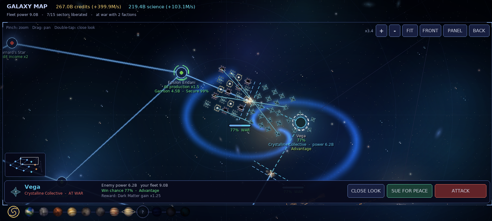

The canvas is made to match the shape of the screen (for example 1600x720 on a 20:9 phone), so it fills it without black bars; the buttons on the galaxy map are bigger and taps are forgiving. There is no Dev tab, and no Fullscreen or Size settings (the game always fills the screen). On a small phone the text is small - it is more comfortable on a tablet or a large phone.

**Build it yourself** (Linux, Java 17, about 10 GB of disk for the Android SDK and NDK; the first build takes a while):

```sh
pip install buildozer "cython==0.29.36"
buildozer android debug          # the APK ends up in bin/
```

`buildozer.spec` holds the settings and pins a python-for-android release that builds pygame 2.1.0 with Python 3.10; the release workflow builds the APK the same way for every `v*` tag. You can try the touch interface on a computer: `python3 space_miner.py --touch --resolution 1600x720` (the mouse acts as a finger).

> **Status:** the touch interface is tested with simulated gestures and a fuzz test, but the APK build itself has not been run yet. If the first run of the *Release* workflow fails on Android, the Linux release is still published and the build log is attached to the run.

## Quick start (from source)

```sh
git clone https://github.com/notyourbusinessss/PasstimeLinuxGame.git
cd PasstimeLinuxGame
./play.sh
```

`play.sh` installs pygame if it is missing and starts the game. You need Python 3.9+ and a desktop session.
Prefer to do it by hand?

```sh
pip install pygame
python3 space_miner.py
```

On distros where pip refuses to install into the system Python ("externally managed environment"), use a virtual environment:

```sh
python3 -m venv venv
./venv/bin/pip install pygame
./venv/bin/python space_miner.py
```

Missing Python or pip? Debian/Ubuntu: `sudo apt install python3 python3-pip python3-venv` - Fedora: `sudo dnf install python3 python3-pip` - Arch: `sudo pacman -S python python-pip`.

## Controls

| Input | Action |
|---|---|
| Click an asteroid / **SPACE** | Mine ore |
| Click the planets along the bottom | Travel to an unlocked planet (or open the Planets tab for a locked one) |
| **1** - **9** | Switch panel tab (Ships, Upgrades, Colony, Planets, Galaxy, Tech, Quests, Warp, Awards) |
| **G** | Open / close the galaxy map |
| Mouse wheel over the galaxy map | Zoom in and out (towards the cursor) |
| Drag on the galaxy map | Pan the map |
| Drag from a system you hold to a star | Attack it (see [Attacking from the map](#attacking-from-the-map)) |
| **SPACE** on the galaxy map | Launch the recommended attack |
| **+** / **-**, arrow keys | Zoom / pan the galaxy map from the keyboard |
| **Z**, or double-click a system | Close look at the selected system and its front (press **Z** again to zoom back out) |
| **H** | Frame all your territory on the galaxy map |
| Mouse wheel over the panel | Scroll the list |
| Click a golden supply crate | Grab it before it drifts off |
| **0** / **F1** | Jump to the Dev tab (only in [developer mode](#developer-mode)) |
| **F11** or **Alt+Enter** | Toggle fullscreen |
| **Esc** | Leave fullscreen; in a window it quits (the game saves on exit) |

### Window, resolution and fullscreen

The window is resizable: drag its edges, maximise it with your window manager, or press **F11** (or start with `./play.sh --fullscreen`). The game scales smoothly to fit, with black bars if the shape of your screen is different.

The game can also be played at a **higher resolution**. A bigger canvas is not just a bigger picture - everything is laid out again, so you get more room: a taller and slightly wider side panel (more rows at once), a bigger and crisper galaxy map, and a larger field of asteroids around the planet.

| Size | Good for |
|---|---|
| 1280x720 | small screens and slower computers (the original layout) |
| 1600x900 | a window on a 1080p screen |
| 1920x1080 | fullscreen on a 1080p screen, or a window on 1440p / 4K |
| 2560x1440 | fullscreen on a 1440p screen, or a window on 4K |

**Auto** (the default) picks the biggest size that fits your screen - what fits in a window, or the whole desktop's resolution when you go fullscreen, so F11 on a 1080p monitor gives you a native 1920x1080 picture. Choose a fixed size with the **Size** button in *Awards -> Stats -> Settings* (it is remembered) or for one run with `--resolution 1920x1080`. Bigger sizes need a faster computer: on the test machine a frame takes about 6 ms at 1280x720, 10 ms at 1920x1080 and 18 ms at 2560x1440.

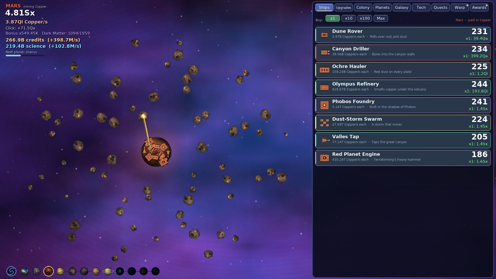

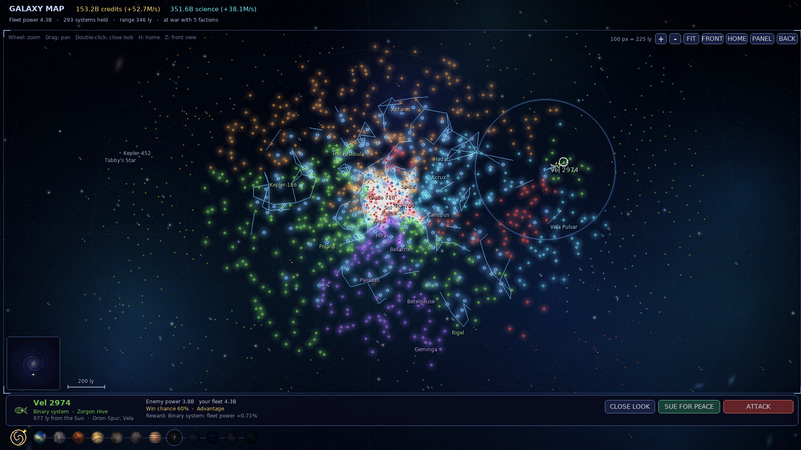

Command-line options: `--new-game` (start over, see below), `--fullscreen`, `--resolution WxH`, `--touch`, `--debug` (verbose log, also printed in the terminal), `--dev` ([developer mode](#developer-mode)), `--version`, `--help`.

Your save lives in `~/.space_miner_save.json`.

**Starting over.** From a terminal, run `python3 space_miner.py --new-game` (or `./play.sh --new-game`, or `space-miner --new-game` for the Linux build). It asks you to type `yes`, erases the save and its backup, and starts a brand-new game; add `--yes` to skip the question. The old save is not thrown away: it is kept next to the new one as `~/.space_miner_save.json.before-reset-DATE` (delete that file if you do not want it). Inside the game, *Awards -> Stats -> Hard reset (wipe save)* does the same without a copy. For a softer start over that keeps your achievements and Stardust, use **Ascension** ([New Game+](#9-ascension-new-game)).

## How the game works

### 1. Mine the asteroids

The planet you are visiting sits in the middle of the screen with asteroids orbiting it. Each click mines ore, shown in that planet's own ore type. Buy **ships** and they circle the planet, laser the asteroids and mine for you. Ships cost the same ore they mine, and each one gets pricier (+15%) than the last.


There are 10 ship **classes**, from the humble Drone to the Galaxy Ark, and **every planet has its own fleet of them**: a Dune Rover on Mars and a Ring Skipper on Saturn are both Drones (same price and output), but they have their own names, descriptions, **hulls, colours, flight paths and lasers**, so you can tell where you are by the fleet alone. A new ship type shows up as `???` once you own the one before it.

| Planet | The ships | How they fly | Their laser |
|---|---|---|---|
| Earth | Classic angular hulls | Round the planet | A straight beam |
| Moon | Silver landers on spindly legs | Hop in the low gravity | A stream of shots |
| Mars | Rust-red wheeled rovers | Drive over the face of the planet | A thick, jolting drill beam with sparks |
| Venus | Cream airships and balloons | Float and bob | A wide, soft beam |
| Mercury | Black and gold sun-shields and solar wings | A lopsided orbit: fast and close, slow and far | A white-hot lens beam with a flare |
| Ceres | Tumbling rocks with claws and drills | Wander about, wobbling | A ragged, flickering charge |
| Jupiter | Striped storm hulls | Spiral in and out | Lightning |
| Saturn | Discs with tilted rings | All in one flat ring plane | Twin parallel beams |
| Uranus | Ice-blue crystals | Over the poles, round the sideways planet | A beam that splits into a fan |
| Neptune | Deep-sea creatures: fish, manta rays, tridents, squid | Weave through the dark | A wavy beam |
| Pluto | Pale ice sleds, snowballs and hearts | A slow, wide, lonely drift | Slow ice shards |
| Kuiper Belt | Comets and snowballs: mauve nuclei with glowing tails | Long, lopsided comet orbits | Bright comet heads racing down a line |

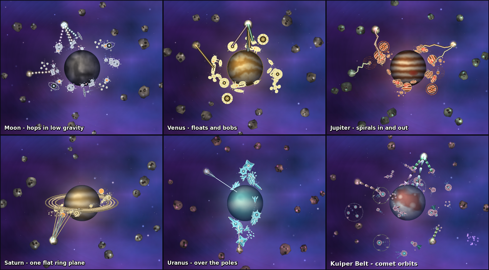

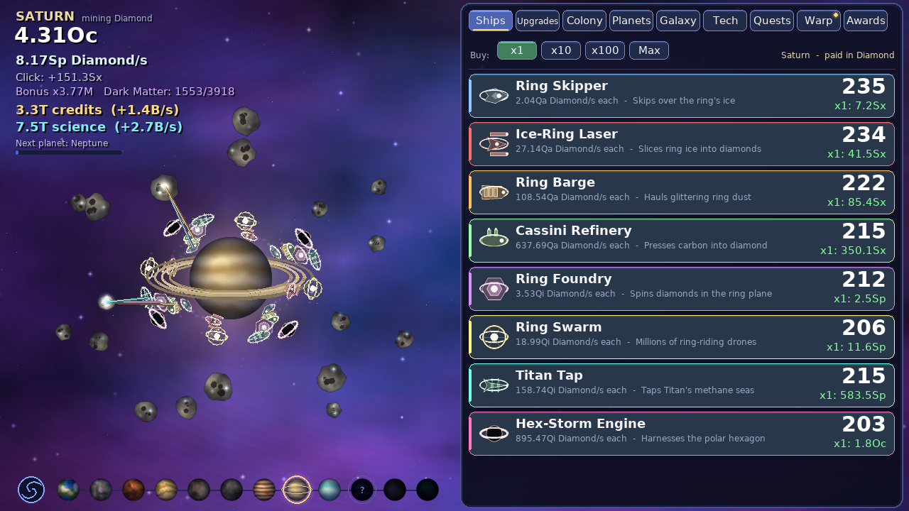

| Class | Base cost | Base ore/sec | On Earth | On Mars | On Venus | On Saturn |
|---|---|---|---|---|---|---|
| Drone | 15 | 0.10 | Mining Drone | Dune Rover | Cloud Skimmer | Ring Skipper |
| Rig | 100 | 1 | Laser Rig | Canyon Driller | Acid Lance | Ice-Ring Laser |
| Barge | 1.1K | 8 | Mining Barge | Ochre Hauler | Aerostat Barge | Ring Barge |
| Refinery | 12.0K | 47 | Refinery Ship | Olympus Refinery | Sulfur Refinery | Cassini Refinery |
| Foundry | 130.0K | 260 | Orbital Foundry | Phobos Foundry | Sky Foundry | Ring Foundry |
| Swarm | 1.4M | 1.4K | Dyson Swarm | Dust-Storm Swarm | Storm Swarm | Ring Swarm |
| Tap | 20.0M | 7.8K | Neutron Tap | Valles Tap | Pressure Tap | Titan Tap |
| Engine | 330.0M | 44.0K | Black Hole Engine | Red Planet Engine | Deep-Crush Engine | Hex-Storm Engine |
| Citadel | 6.0B | 110.0K | Star Citadel | Olympus Citadel | Cloud Citadel | Ring Citadel |
| Ark | 60.0B | 280.0K | Galaxy Ark | Ares Ark | Storm-Eye Ark | Ring-Lord Ark |

The two biggest classes, **Citadel** and **Ark**, are not new hulls but **formations of the planet's own ships**: a Citadel is a flagship (the planet's Engine hull) with four escorts under a halo, an Ark a line of three flagships with their escorts inside a ring, so a Saturn Ark is three ringed discs and a Neptune Ark three deep-sea creatures. They are drawn larger than the other ships, circle the planet like the rest and lead the fleets you see on the galaxy map. They are priced on the same ladder (a Citadel only pays off once you have a dozen or so Engines on the planet, an Ark after about ten Citadels), fight only a little better than an Engine (fleet power 2,624 and 3,149 for one ship against 2,187: they are for mining and for show, and the pace of the game stays the same) and come with their own Mk2 - Mk6 upgrades and "Fan" achievements.

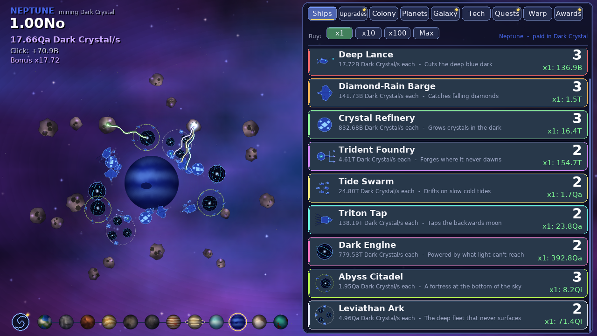

All twelve rosters (`ships.py`; `python tools/ship_sheet.py out.png --names` draws this picture):

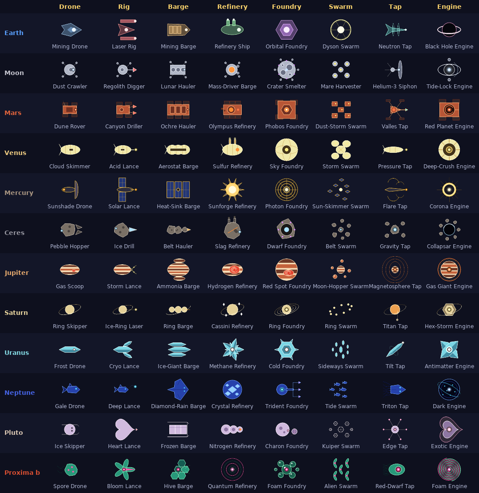

The Upgrades tab uses the planet's own ship names too (and techs and the "Fan" achievements talk about the classes):

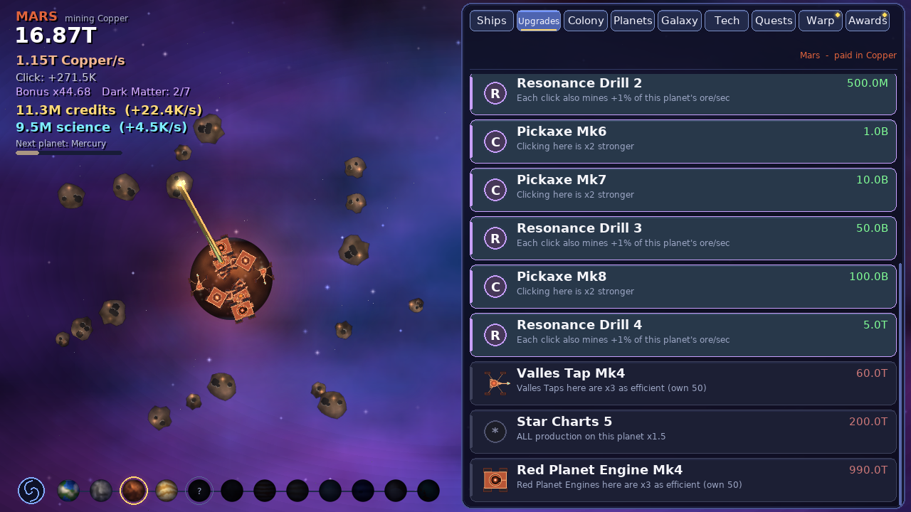

*(Costs and output are multiplied by 10 for every planet further out, so the first drone on the Moon costs 150 Silicon and mines 1 Silicon/sec, and on Mars 1.5K Copper and 10 Copper/sec.)*

### 2. Upgrades

The **Upgrades** tab lists what you can buy on the current planet with its ore: ship multipliers that unlock as you own more of a ship (x2, x2, x3, x3, x5), stronger clicks, drills that make each click also mine a share of your ore/sec, and *Star Charts* that boost the whole planet. **Buy everything affordable** is one click.


### 3. Unlock and travel to new planets

Open the **Planets** tab. The next planet is unlocked by paying ore from the worlds *behind* it - usually the previous planet's ore, plus a little of the one before that, plus credits later on. Unlocking gives you:

1. a **new ore** to mine on its own asteroids,
2. an empty **fleet, upgrade shop and colony** to build,
3. a permanent **planet bonus** that helps everywhere (clicks, cheaper ships, production multipliers, offline progress...).

Once a planet is unlocked, click it in the bottom strip (or the Planets tab) to fly there. A short hyperspace jump later you are mining a new ore. **Every unlocked planet keeps producing while you are somewhere else.**


| # | Planet | Ore | Planet bonus |
|---|---|---|---|
| 1 | Earth | Iron | Home world - where it all begins |
| 2 | Moon | Silicon | Low-gravity rigs: clicks x2 |
| 3 | Mars | Copper | Martian foundries: ships 5% cheaper everywhere |
| 4 | Venus | Silver | Trade winds: credit income x1.5 |
| 5 | Mercury | Gold | Solar farms: all ore production x1.5 |
| 6 | Ceres | Platinum | Belt beacons: crates 25% more often, pay x2 |
| 7 | Jupiter | Helium-3 | Gas-giant labs: science income x2 |
| 8 | Saturn | Diamond | Ring-miners: ships 5% cheaper, clicks x2 |
| 9 | Uranus | Antimatter | Cold engines: all ore production x2 |
| 10 | Neptune | Dark Crystal | Deep-space drift: offline progress at 75% |
| 11 | Pluto | Exotic Matter | Edge of the system: Dark Matter gain x1.5 |
| 12 | Kuiper Belt | Tholin | Comet harvesters: all ore production x3, buildings x1.5 |

The solar system ends at the **Kuiper Belt**: a dwarf world of ice with dark tholin patches, mined for Tholin by a fleet of comets and snowballs that sweep round it on long comet orbits (the planets of other stars - Proxima Centauri, TRAPPIST-1 - are systems you conquer on the galaxy map).

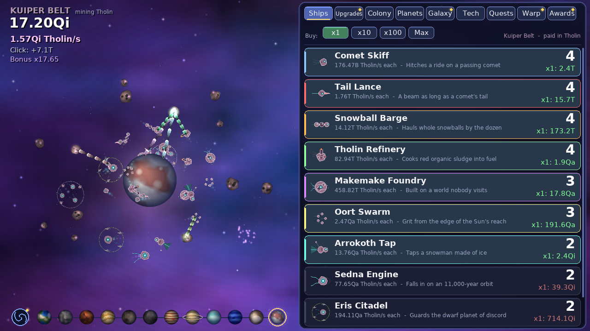

**The planets of other stars.** Liberating a star shows you what orbits it. Open the **Planets** tab and its **All worlds** page: every world you have found, nearest star first, with filters (*All*, *Habitable*, *Rocky*, *Giants*, and the star you selected on the map), a card with the world's picture, size, temperature, year and distance from its star, and a *Show on the map* button. The map's bar tells you how many worlds a system you hold has, a toast announces the stars with real planets and the first habitable world you find, and the Planets tab shows a dot while there are worlds you have not looked at.

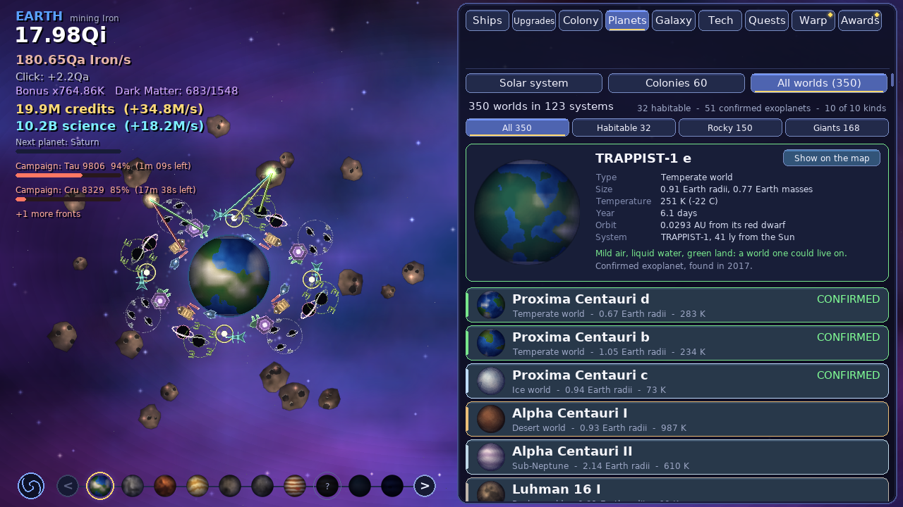

About 30 of the game's real stars (TRAPPIST-1, Proxima Centauri, Kepler-186, Tau Ceti, 55 Cancri, Gliese 581 and 667...) show their **real, confirmed planets** from the [Open Exoplanet Catalogue](https://github.com/OpenExoplanetCatalogue/oec_gzip) (MIT licence): 89 in all, with their real names, sizes, temperatures, years and the year they were found. Every other star gets a generated system that fits its kind - a red dwarf several small close-in planets, a giant or a pulsar a few, a nebula or a cluster none - and it is the same every time, because it is worked out from the star and not stored in the save. Each world is sorted by its size and temperature into one of ten kinds - *temperate*, *ocean*, *rocky*, *desert*, *ice*, *lava*, *dwarf planet*, *sub-Neptune*, *ice giant* and *gas giant* (some with rings) - and has its own procedural picture.

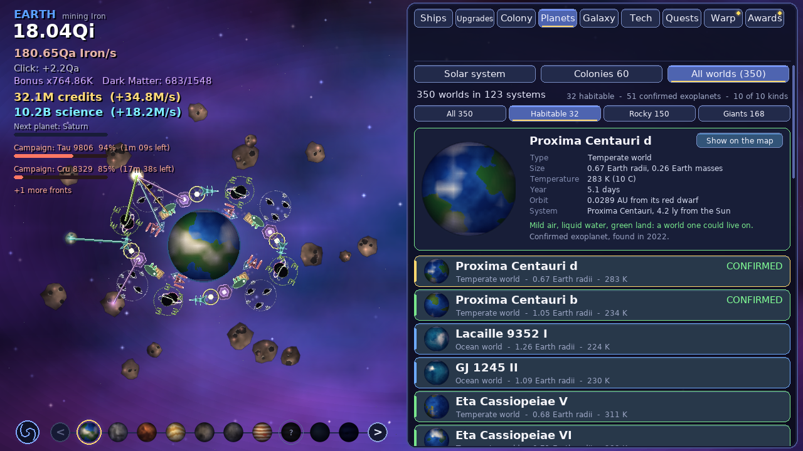

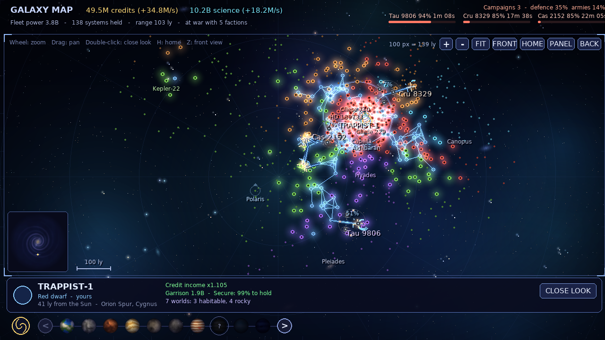

They come with achievements of their own: *First Light* to *Worldbuilder* (5,000 worlds), *Goldilocks* to *A Home for Everyone* (habitable worlds), *Known Worlds* and *Exoplanet Archivist* (real planets), *Planetary Zoo* (all ten kinds) and *Seven Sisters* (liberate TRAPPIST-1).

#### Colony worlds: the whole galaxy is the game

The twelve planets of the solar system are only the first system. **Every world of every star you liberate can be settled** and played like a planet of its own: its own ore, its own fleet, upgrades, colony buildings and planet bonus. Open the **Planets** tab and its **Colonies** page.

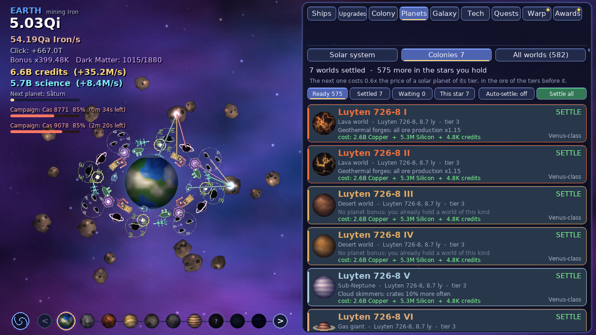

- **Tiers.** Every planet has an economy *tier*: its ore is worth 10 times more per tier, and its ships and buildings are priced on it. A solar planet's tier is its place in the line (Earth 0 ... the Kuiper Belt 11). The tier of any other world follows from the **strength of its star**: a weak star near the Sun gives tier 3 worlds (Venus-class), TRAPPIST-1 tier 5 (Ceres-class), the strong and far stars tier 9 and 10.
- **Settling.** A world costs a share of the unlock price of a solar planet of its tier, paid in the ore of the planets of the **two tiers before it** - any planet of those tiers pays, the richest you have, solar or colony - and credits. It costs 6% more for every colony you already have. If you have no planet of the tier before it yet, the world is *waiting*. The page lists the worlds that are *ready*, the ones you have *settled*, the ones *waiting*, and the worlds of the *selected star*; **Settle all** settles everything you can pay for, and the **Colonial Office** tech can settle one by itself every few seconds (*Auto-settle* on the page).
- **Bonuses.** The first world of each of the ten kinds you settle brings that kind's planet bonus (temperate: credit income x1.1, lava: all ore x1.15, gas giant: fleet power x1.1...); later worlds of the same kind bring none. Every colony adds 0.3% to your production.
- **Fleets.** A colony flies the ships of the solar planet its kind of world looks like: desert worlds the Mars ships, gas giants the Jupiter ones, ocean worlds the Neptune ones, with a hint of their own colour.
- **The strip and the planet view.** The planet strip at the bottom scrolls (arrows at both ends) and shows your settled worlds after the solar planets; a colony has the same tabs as any planet (ships, upgrades, colony buildings; no megaproject), its own asteroids and its own ore.

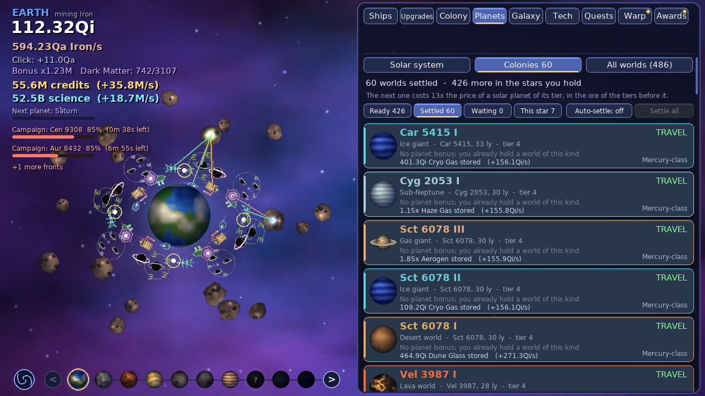

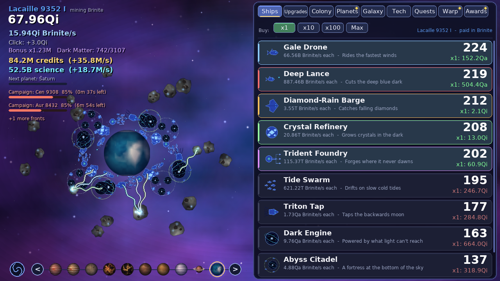

**Why they are slow-burn.** Dozens of full planets would be dozens of engines, so a colony is built to be an empire to grow rather than a shortcut: it mines **10%** of the ore a solar planet of its tier would, its ships fight at **10%**, its Fusion Reactors and Defense Grids count 2% and its Habitat Domes and Research Labs 1%. With the balancing bot (which settles worlds as soon as it can) the game keeps its pace: the first Ascension still comes after about 45 - 55 hours and the Kuiper Belt a bit sooner than before. **Warp** keeps your colonies, **Ascension** takes them with the rest of your planets.

A "Next planet" progress bar in the top-left corner shows how close you are, and hovering a planet in the bottom strip lists exactly what it costs.


### 4. Colonies and megaprojects

The **Colony** tab lets you build on the current planet. Credits and Science, which you need for techs and megaprojects, come from here.

| Building | Paid in | What it does |
|---|---|---|
| Mining Complex | that planet's ore | +3% ore output here / level |
| Habitat Dome | that planet's ore | Produces Credits |
| Research Lab | that planet's ore | Produces Science |
| Shipyard | credits | -0.6% ship prices here / level |
| Fusion Reactor | credits | +2.5% ALL production / level |
| Defense Grid | science | +4% crate frequency, +10% defense vs raids / level |

Each planet gives a x2 boost to one building type (the Kuiper Belt boosts all of them x1.5), and buildings go up to level 50.

Every planet also has one **megaproject** at the bottom of its Colony tab. It costs a huge pile of that planet's ore *plus* credits and science, and it permanently boosts your whole empire - even through Warps. That is what makes the old ores worth keeping.


| Planet | Megaproject | Effect |
|---|---|---|
| Earth | Orbital Ring | Ships 10% cheaper everywhere |
| Moon | Lunar Mass Driver | All production x1.5 |
| Mars | Terraformers | All production x2 |
| Venus | Cloud Cities | Credit income x3 |
| Mercury | Solar Array | All production x2 |
| Ceres | Belt Network | Crates 50% more often, pay x2 |
| Jupiter | Gas Siphons | Science income x3 |
| Saturn | Ring Elevator | All production x2 |
| Uranus | Ice Forges | Ships 10% cheaper everywhere |
| Neptune | Deep Core Mine | All production x3 |
| Pluto | Edge Gate | Dark Matter gain x2 |
| Kuiper Belt | Comet Catchers | All production x5 |

### 5. Tech tree

Science buys the **Tech** tree: 32 techs with prerequisites. They include automatic ship buying and upgrade buying (they only ever spend up to 25% of a stockpile so you can still save for planets), automatic crate collection, big production multipliers, cheaper ships, head-start ore after a Warp and more. Techs stay forever.


### 6. Quests, crates and random events

- **Quests** - three rotating goals (click asteroids, buy ships, mine ore, grab crates, upgrade colonies, resolve events...). Fill the bar and claim ore, credits, science or a Mining Frenzy.
- **Supply crates** - a golden crate drifts across the screen every minute or so. Grab it for ore, credits or a x7 *Mining Frenzy*.
- **Random events** - every few minutes something happens at the planet you are on: meteor showers, pirate raids, solar flares, a cosmic lottery, derelict ships, alien traders, research grants, distress signals and, very rarely, a whisper from the void. Most give you a risky option and a safe one.


### 7. The galaxy: the Milky Way, campaigns and raids

Once you unlock **Mars** the **galaxy map** opens (the spiral button at the far left of the planet strip, or press **G**). It is the **real Milky Way**, seen from above: the Sun at the bottom, the Galactic Centre in the middle, the four spiral arms and the bar painted from their real shape. On it are **more than 6,000 star systems** you can conquer:

- about **140 real stars and objects** at their real distances and directions: your neighbours Proxima Centauri, Alpha Centauri, Barnard's Star, Sirius and Tau Ceti; bright stars like Vega, Betelgeuse and Rigel; the Orion, Crab and Eagle nebulae; the Vela and Geminga pulsars; Cygnus X-1; Omega Centauri; and, at the middle of the galaxy, **Sagittarius A\*** - the Devourer's throne;
- thousands of **generated systems** between them, spread over the real arms, bar and bulge: dense around the Sun and thinning out with distance, so that every size of jump has plenty of targets.

The systems are held by hostile factions - Pirate Syndicate, Zorgon Hive, Crystalline Collective, Ironclad Dominion, Void Cult and, around the Galactic Centre, the final boss **The Devourer**. You see the systems that are within your sensors (two jump ranges of your territory) and the famous places; the rest of the galaxy is still dark.

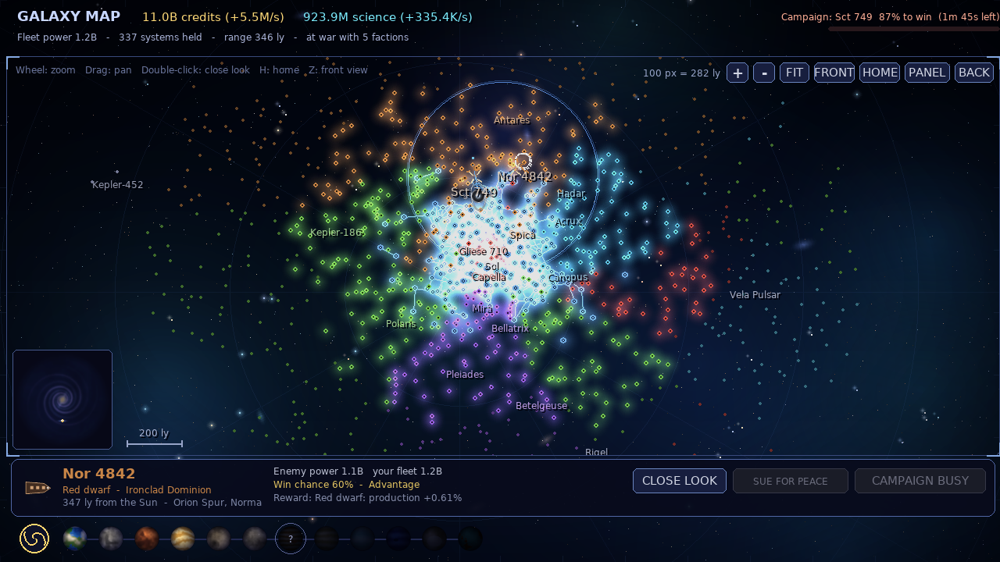

**Free travel, limited by your jump range.** There is no fixed path: you can attack **any system within your Jump Drive's range of a system you already hold**, so your empire grows in whatever direction you like. The range starts at 6 light-years (enough for Alpha Centauri and Barnard's Star) and the **Jump Drive** (Armory, 22 levels) multiplies it by 1.5 per level:

| Level | 0 | 5 | 10 | 14 | 18 | 22 |
|---|---|---|---|---|---|---|
| Range | 6 ly | 46 ly | 346 ly | 1,752 ly | 8,877 ly | 44,891 ly |

Power grows with the distance from the Sun, from a few thousand near home to the Devourer's trillions at the Galactic Centre (26,670 light-years away). The far side of the galaxy, beyond the centre, is stronger still.

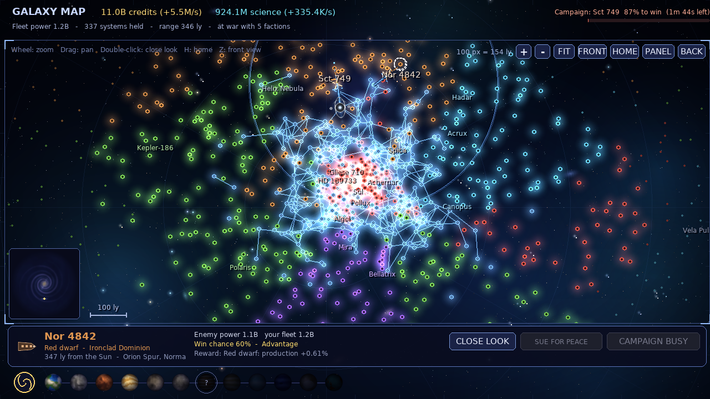

**Rewards.** Every system you liberate gives a permanent bonus that survives Warps:

- **Famous places** have rewards of their own (Alpha Centauri: all production x1.3, Sirius: science x2, Procyon: clicks x10, the Orion Nebula, the Crab Nebula, the Galactic Core, the Void Throne...), listed at the end of this section. About 45 of them, from Fomalhaut to Eta Carinae, give smaller bonuses.
- **Generated systems** give a small bonus that depends on what they are: red and orange dwarfs and clusters add production, yellow dwarfs and blue giants credits, white dwarfs, pulsars and supernova remnants science, binaries, supergiants and neutron stars fleet power, brown dwarfs clicks, black holes Dark Matter, nebulae supply crates, and white stars cheaper ships. Stronger systems give more, and the sum of all of them counts with diminishing returns so that thousands of conquests stay balanced.

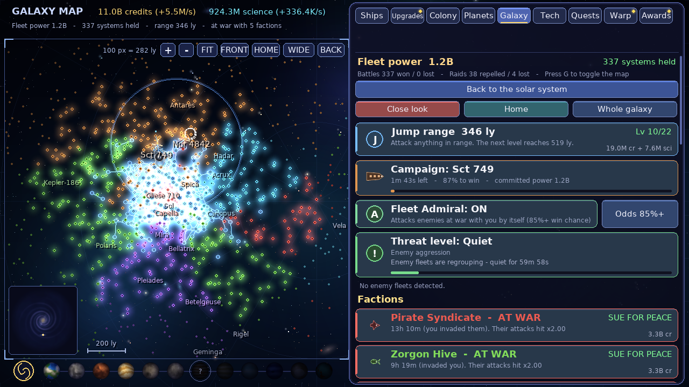

**Fleet power.** Your fleet's strength comes from the ships you own on all your planets (bigger ships count for far more), boosted by your Weapons upgrades, your Defense Grids, your overall production bonus and the systems you have liberated. It is shown on the Galaxy tab.

#### Attacking from the map

You do not have to open any panel to wage war. On the galaxy map:

- **Drag from a system you hold to a star you want** and let go. An arrow follows the pointer, snaps to the star under it and shows its name and your **win chance** before you drop (a red arrow says why the attack is not possible); dropping launches the campaign from the nearest of your systems. A faction at peace with you asks first, on the map, in a bar with **ATTACK** and **CANCEL**. A drag that starts on empty space still pans the map, and a drag dropped on nothing does nothing.
- A **pulsing gold ring marked BEST** shows the attack worth launching now: among the systems in reach that no fleet is attacking yet and that your free fleet beats with at least **90%** odds, the ones of factions you are at war with first, then the strongest (the best reward), then the nearest. Press **SPACE** on the map, or the **ATTACK BEST** button, to launch it. With nothing to launch it says why (all fronts busy, no fleet free, nothing within your odds).
- The **campaigns dock** in the top-left corner of the map is always there: how many fronts are in use (and how many are run by generals), the four campaigns closest to arriving with their win chance, ETA and a progress bar (click one to look at it), and the **ATTACK BEST** button. The incoming-attack chips sit under it.

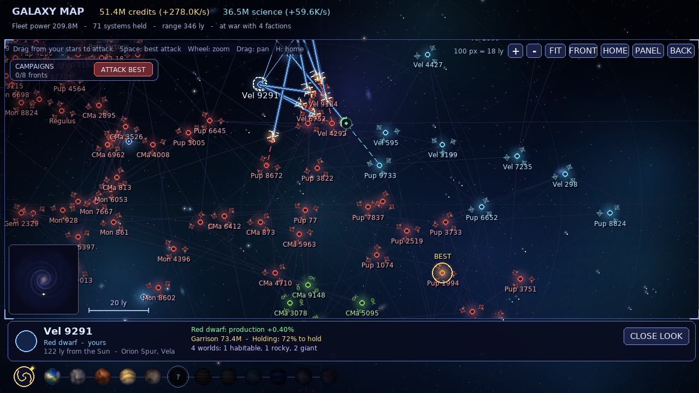

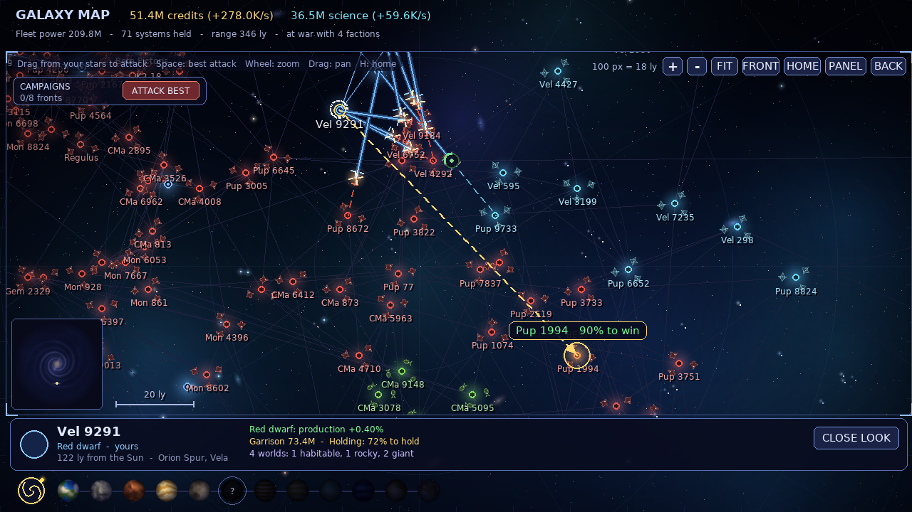

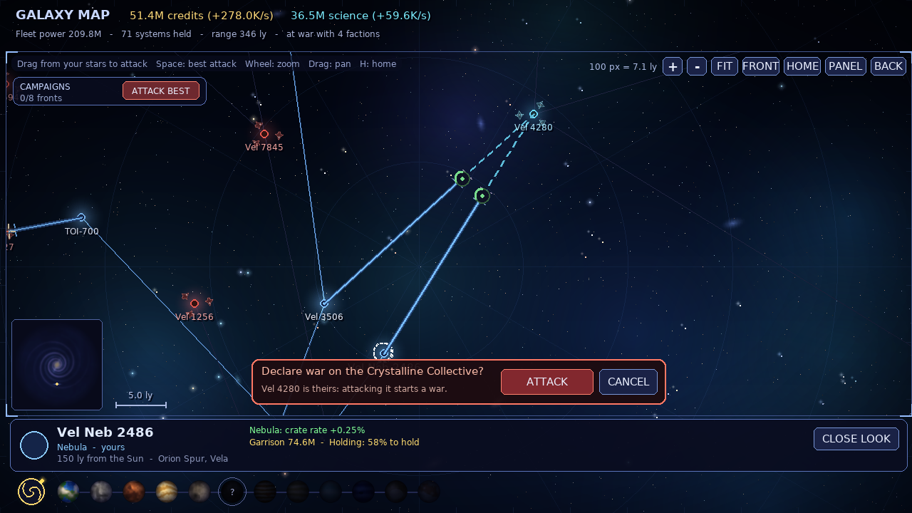

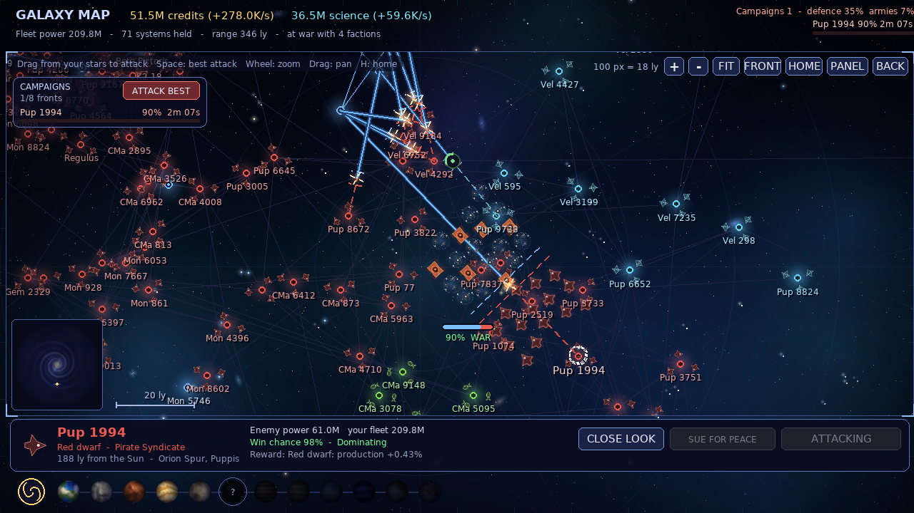

**Campaigns.** Pick a system you can reach on the map or in the *Galaxy* tab and press **ATTACK** (or **DECLARE WAR**, if you are at peace with that faction - see [War and peace](#war-and-peace)). The part of your fleet that is sent is committed (see [Generals and wardens](#generals-and-wardens-the-war-on-standing-orders)) and a campaign timer runs while you keep playing: longer against stronger systems, plus the flight from your nearest system. When it ends the game rolls the dice using the win chance shown beforehand (it depends on the power sent against the system's).

- **Victory** - the system is liberated and its **permanent bonus** is yours. You lose a few ships: about 1% of the ships you sent for an even fight, far less for an easy win.
- **Defeat** - you lose about 8% of the ships you sent and can try again once you are stronger.

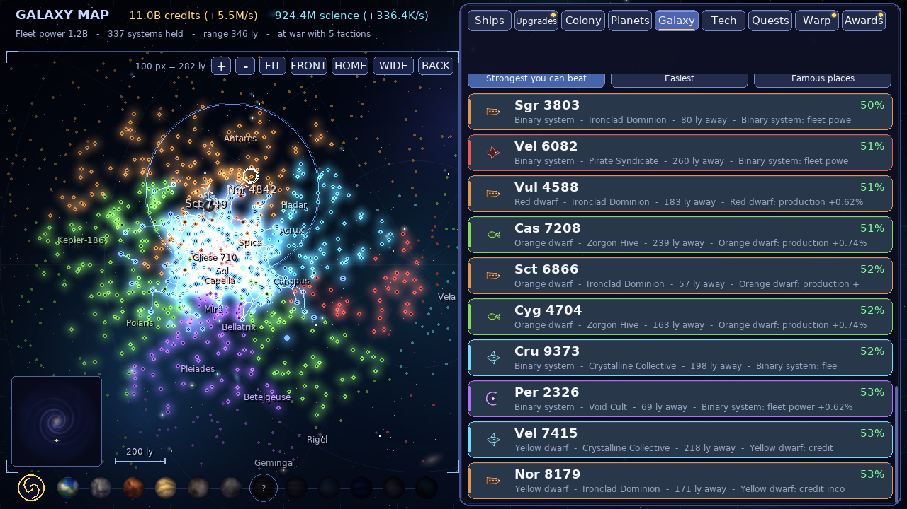

The **Targets** list at the bottom of the Galaxy tab shows what is in range: the strongest systems you can beat, the easiest ones, or the famous places.

**Fleet Admiral.** The tech of that name (31st in the Tech tree) lets your fleet launch campaigns by itself: against the factions you are **at war with** only, and only against systems that the manual pool beats with the chosen odds (70%, 85% or 95%), sending just the force that gives those odds. It fills the manual campaign slots; your generals have their own orders (see below). Switch it on in the Galaxy tab. It never declares a war on its own.


#### Generals and wardens: the war on standing orders

You do not have to launch every campaign yourself. **Liberating a famous star earns you a commander for good**: eight **generals** run the offence and four **wardens** the defence. The twelve *command systems* are marked on the map with a ring (gold for a general, blue with a triangle for a warden), and the *Generals* and *Defence* pages of the Galaxy tab list the ones you have still to earn:

| Command system | Distance | Commander | Role | Trait |
|---|---|---|---|---|
| Alpha Centauri | 4.4 ly | Ada Voss | General | Pathfinder: Campaigns are 15% faster |
| Barnard's Star | 6.0 ly | Bastion Hale | Warden | Bastion: Defence of its region x1.3 |
| Sirius | 8.6 ly | Mara Okoye | General | Quartermaster: Loses 30% fewer ships |
| Epsilon Eridani | 10 ly | Ines Marlow | Warden | Bulwark: Defence of its region x1.45 |
| Tau Ceti | 12 ly | Ilya Brandt | General | Tactician: Fights as if 15% stronger |
| Vega | 25 ly | Soren Ito | General | Warlord: Runs one more campaign at a time |
| Arcturus | 37 ly | Zhen Ma | General | Diplomat: Attacks anger the factions half as much |
| Capella | 43 ly | Tomas Reyes | General | Pathfinder: Campaigns are 15% faster |
| Aldebaran | 65 ly | Koa Draven | Warden | Citadel: Defence of its region x1.6 |
| Polaris | 433 ly | Petra Lund | Warden | Aegis: Defence of its region x1.8 |
| Betelgeuse | 548 ly | Nia Calder | General | Tactician: Fights as if 15% stronger |
| Cygnus X-1 | 7,200 ly | Yara Quill | General | Warlord: Runs one more campaign at a time |

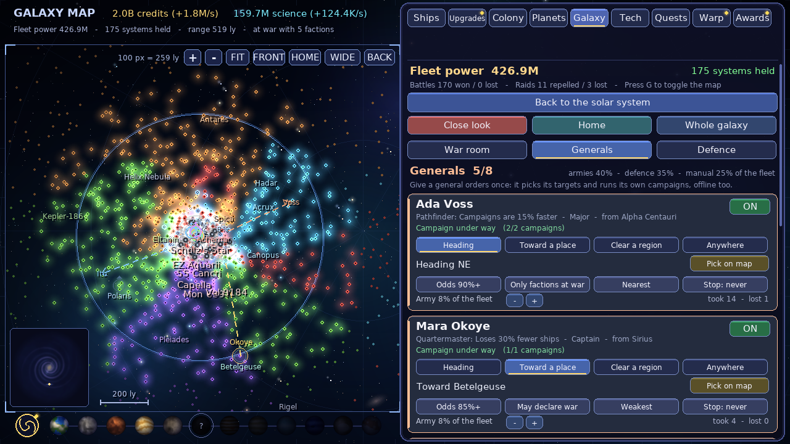

**Three pools of the fleet.** Your whole fleet is split into the **defence** (a slider on the Defence page, 35% to start), the **armies** of your generals and the **manual pool** that is left for the campaigns you launch yourself with ATTACK (the *Send* selector and the Command track work as before, on the manual pool only). Armies on campaign defend nothing, and the defence never leaves home.

**A general's orders** are set once, on its card:
- **Where:** *Heading* ("keep going that way": a compass direction), *Toward a place* (it closes in on a system, one step at a time), *Clear a region* or *Anywhere in reach*. **Pick on map** turns your next click on the map into the order (Esc cancels); a heading shows as an arrow, a place as a dashed line.
- **Under what circumstances:** the minimum win chance (70% to 95%), whether it may **start a war** or fights only factions at war with you, what it prefers (nearest, weakest, strongest, famous places) and when to stop (never, or after 3 / 10 / 25 / 100 conquests).
- **Army:** its share of the fleet. A campaign takes only the smallest force that wins with the chosen odds, so a small army takes many weak systems but never one stronger than it can beat.

The general then picks its own targets under those orders and runs its own campaigns (an army marches slowly: its campaign takes eight times as long as a strike), levels up with every conquest (*Recruit* to *Warlord*; the *General* and *Warlord* ranks and the *Warlord* trait add simultaneous campaigns) and **pauses after two defeats in a row** until you resume it.

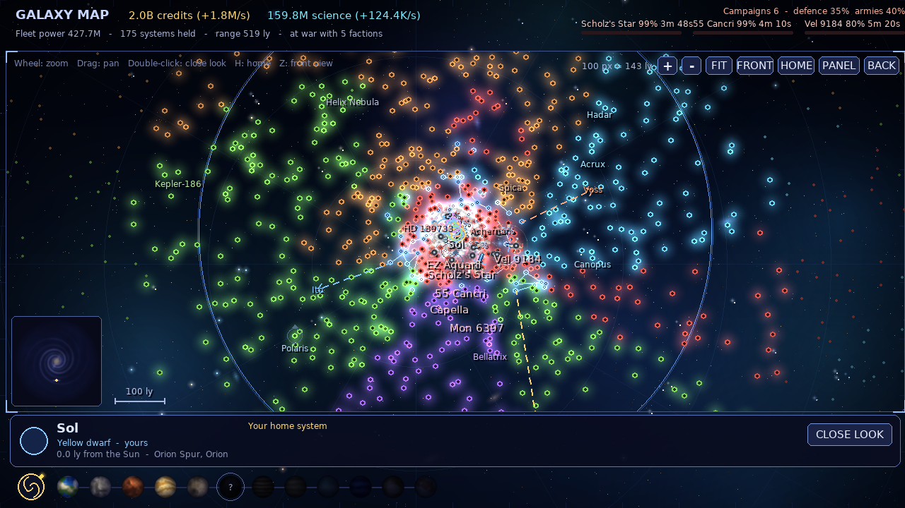

**Defence is simple on purpose.** One slider sets how much of the fleet guards your territory. Every region of the galaxy where an enemy at war with you touches your border gets a **posture** - *Skeleton*, *Balanced* or *Fortress* (shares of 1 : 2 : 3.5) - that decides its share of the pool. A system is held by its **garrison** or by its region's share, whichever is bigger, and attacks that arrive in the same region together share it. A **warden** assigned to a region multiplies its defence (x1.3 to x1.8) and, with *Retake* on, sends part of the defence to take back a system you lose there by itself.

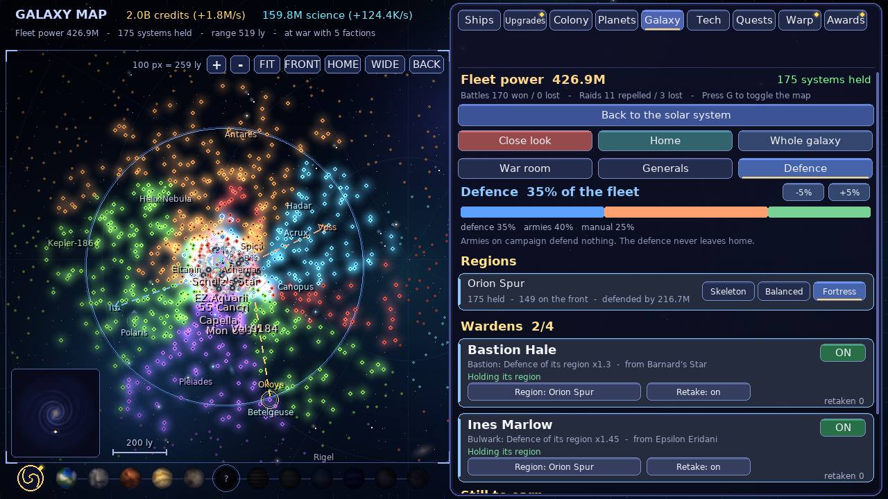

**While you are away** the commanders keep fighting by the same rules, for up to 8 hours: campaigns arrive and generals launch new ones, and a message tells you what happened. The enemy never attacks while the game is closed. The dice are saved with the game, so closing and reopening it cannot reroll a battle. Achievements: *Two-Front War*, *Multi-Front Command* (4 campaigns at once) and *War on Every Front* (8).

#### The galaxy screen

Switching to the galaxy (**G**, or the spiral button at the left of the planet strip) opens a screen of its own, with its own **star-chart background** instead of the planet's sky. Only a slim bar of numbers stays at the top, and the map takes the rest of the window:

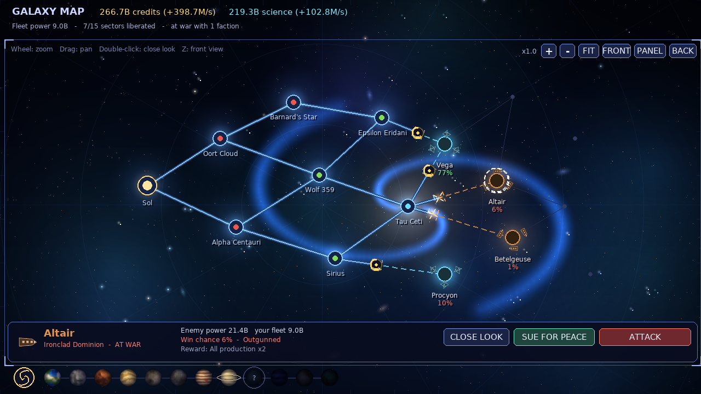

- At the bottom a **command bar** shows the selected system - what it is, how far it is, its power against yours, your win chance, its stance (peace, truce or war) and its reward - with **ATTACK** (or **DECLARE WAR**), **SUE FOR PEACE** and **CLOSE LOOK**. A system out of range says how far it is and what range you have.
- Incoming enemy attacks (with the Intel upgrade) appear as red chips under the toolbar with a **FORTIFY** button, and their fleets sail down the lanes.

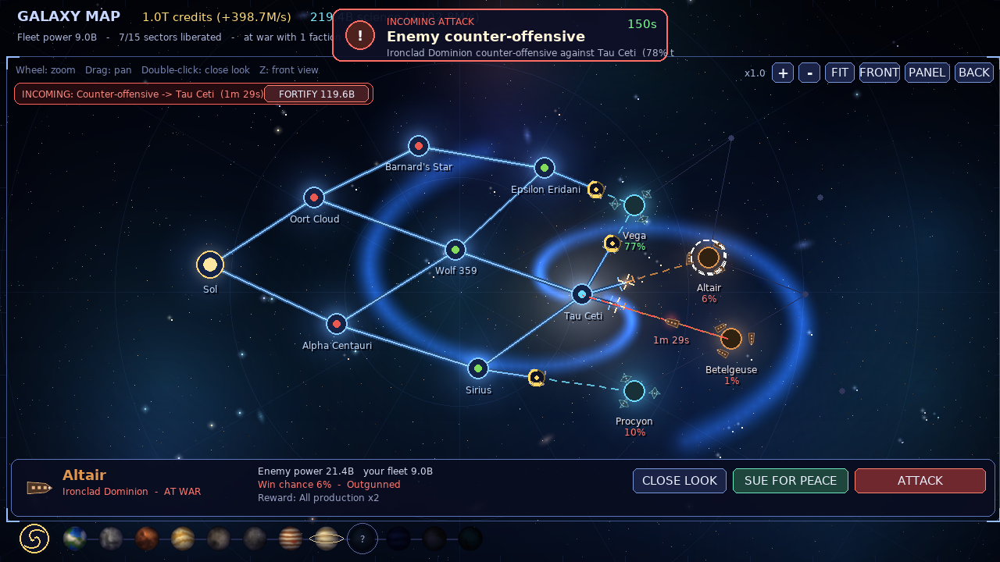

- **PANEL** brings the side panel back (the Armory, the Threat card, Factions, the enemy log...) next to a smaller map; **WIDE** hides it again; **BACK** returns to the solar system. The choice is remembered.

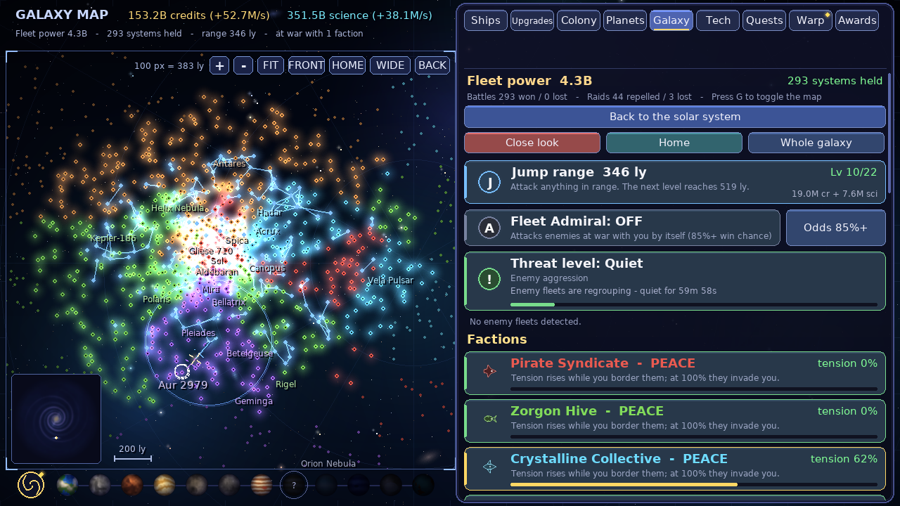

#### Close look: the frontlines

The galaxy map zooms from the whole Milky Way (a hundred thousand light-years across) down to a single star: scroll the **mouse wheel** to zoom towards the cursor, **drag** to pan (or use **+** / **-** and the arrow keys), and use the buttons in the corner: **+**, **-**, **FIT** (the whole galaxy), **HOME** (all your territory, also **H**) and **FRONT** (zoom in on the selected system and its front - **Z** and a double-click on a system do the same). A ruler shows the scale, a mini-map shows where you are and you can click it to jump somewhere else. Zoomed in, systems get their names (the famous ones first), your lanes show as blue lines and the range of your Jump Drive as a circle around the system an attack would start from.


Every lane between a system of yours and an enemy system is a **front** (and so is the flight path of a campaign). The battle line sits where the two forces balance: the stronger your fleet is compared with that sector's defenders, the closer to the enemy the line is pushed, and a running campaign pushes it further. Zoomed out you see a clash marker on each front; zoom in and the front turns into a battle:


- **Both fleets** are drawn as swarms facing each other across the battle line. The more power, the bigger the swarm; your ships are the types you actually own, the enemy's are its faction's ships. Lasers and explosions fly while the fight goes on.
- **Power split.** A small bar at each front shows your share of the combined strength and your win chance.
- **Labels** fill in as you zoom: the enemy system's faction, power and a status (*Dominating*, *Advantage*, *Stalemate*, *Under pressure* or *Outgunned*), and for your own systems their reward.
- **Garrison shields.** Every system of yours that borders the enemy wears shield arcs, coloured by how likely it is to hold against a counter-offensive: green *Secure* (80% or more), yellow *Holding* (50% or more), red *Vulnerable*. Fortifying a sector against an incoming attack gives it a gold ring.
- **Incoming attacks** (with the Intel upgrade) appear as an enemy fleet sailing down the lane with a countdown, so you can watch a counter-offensive arrive and see exactly which system it is aimed at.


The **Galaxy tab** has **Close look**, **Home** and **Whole galaxy** buttons and a **Front report** card for the selected system: the status of the fighting, the power split, where an attack would launch from and which systems border it - or, for a system you hold, its garrison, which enemies can reach it and its chance to hold. Clicking the card (or a system in the list) takes the map there.


**Armory.** Credits and Science buy permanent military upgrades:

| Upgrade | Max level | Effect |
|---|---|---|
| Weapons | 20 | Fleet power x1.2 per level |
| Armor | 12 | Fleet losses -6% per level |
| Engines | 15 | Campaigns 8% faster per level |
| Shields | 10 | Raid losses -8% per level |
| Intel | 8 | Enemy attacks are announced earlier and in more detail (see *The Threat Director* below) |
| Jump Drive | 22 | Jump range x1.5 per level (6 ly at level 0): you can attack any system within range of one you hold |
| Command | 7 | +1 manual campaign at a time per level (your generals run their own: see [Generals and wardens](#generals-and-wardens-the-war-on-standing-orders)) |

**Raids.** While you are at war with a faction whose systems border your territory (a system *borders* yours when it is one of its nearest neighbours on the map), it **raids your planets**. Your ships and **Defense Grid** buildings (+10% defense per level) fight them off: you get credits for repelling a raid, or lose some of that planet's ore if the defence fails. If you are on the raided planet you watch it happen:


#### War and peace

The galaxy starts at peace, and **nobody attacks you until a war starts**. A war starts in exactly one of two ways: you decide to invade, or you are invaded.

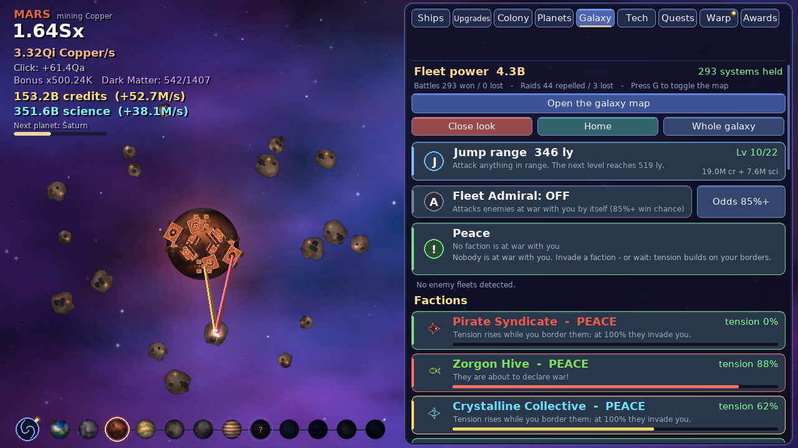

- **You invade.** Press **DECLARE WAR** on a system of a faction at peace (the button asks you to click twice). The campaign starts, and from then on that faction's fleets raid your planets and counter-attack your border sectors.

  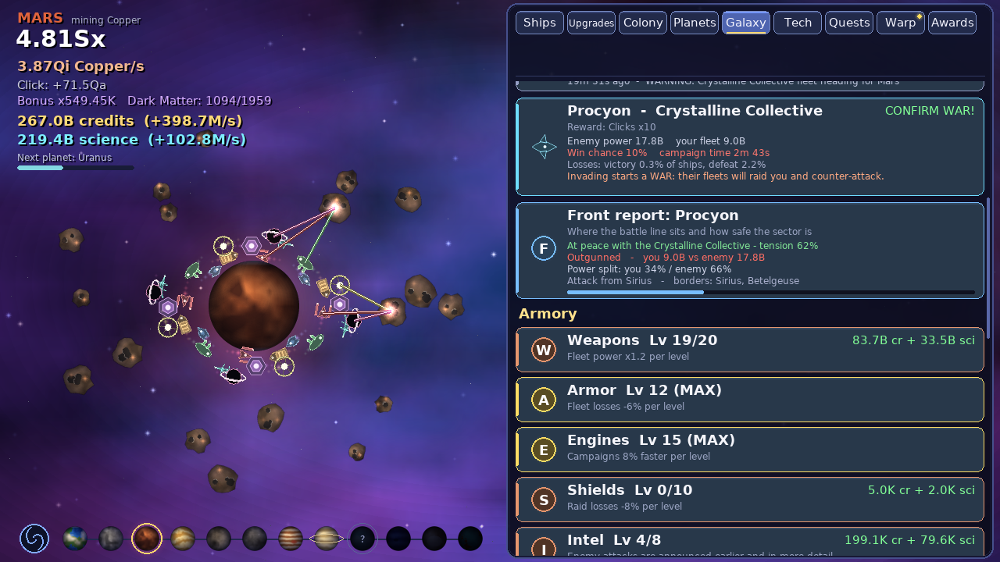

- **You are invaded.** Every faction that borders your territory builds **tension** towards you, shown on the *Factions* card in the Galaxy tab. About 90 minutes of border contact fills it (the Pirate Syndicate lose patience first, the Crystalline Collective last, and the more systems you hold the faster it goes). At 80% you get a warning; at 100% the faction **declares war** and opens with a counter-offensive on your weakest border sector, or a raid.

  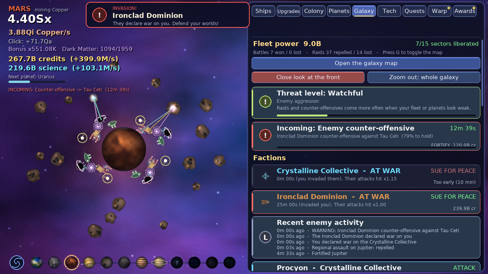

Only factions at war with you attack, and only from the systems that border you - the rest of the galaxy stays quiet. Everything described below under *Raids* and *The Threat Director* happens during a war.

**Ending a war.** After 10 minutes of war you can **sue for peace** (it costs about ten minutes of your credit income, and you cannot do it while your fleet is attacking that faction). Their fleets turn back and a **truce** holds for 45 minutes: no tension, no attacks. Attack them during the truce and it is broken (they get angrier); once it runs out the tension starts building again. A faction with nothing left on the map has nothing to fight with, so that war ends by itself.

On the map the fronts show it: at peace the two fleets just face each other across a calm ring that fills up with tension; at war the front is a battlefield with lasers and explosions.

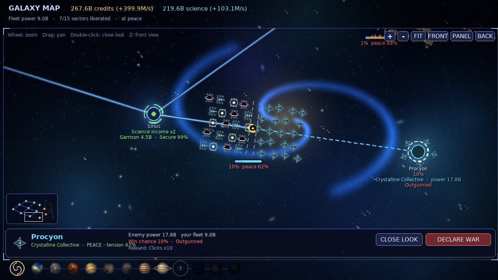

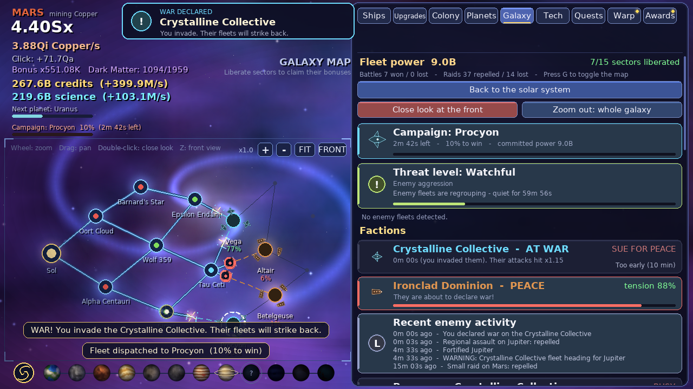

#### The Threat Director

The enemy is not random: while you are at war, a **Threat Director** watches how strong you are compared with the enemy systems that border you and decides when to strike. The Galaxy tab shows its **Threat level** card:


- **Aggression** (Quiet, Watchful, Hostile, Aggressive, Warlike) rises when your fleet is weak next to the nearest enemy, when some of your planets are poorly defended and when you have been attacking a faction recently. The more aggressive the enemy, the more often it attacks.
- **Raids** hit your planets, and the enemy prefers the weakly defended ones. They come in three sizes:

| Raid | Appears once you hold | Power | Planets hit | If you hold | If you lose |
|---|---|---|---|---|---|
| Small raid | - | x1 | 1 | credits | 4% of that planet's ore |
| Regional assault | 3 systems | x3 | 1 | 4x the credits | 10% of that planet's ore |
| System invasion | 8 systems | x6 | 3 at once | 10x the credits | 14% of each planet's ore |

  Your Shields upgrade reduces what a lost raid costs.
- **Counter-offensives** try to **take back a system you liberated** that borders enemy territory. They come from **every enemy faction at war with you at once** (a wave of up to three attacks, never two on the same system) and hit as hard as the enemy next door allows: from 0.8x up to 6x the power of the system they attack, the stronger the enemy system they start from the harder. A system is defended by its **garrison** (the force you sent to take it) or by the **defence pool of its region** (see [Generals and wardens](#generals-and-wardens-the-war-on-standing-orders)), whichever is bigger. So **armies on campaign defend nothing**, and an empire with a thin defence, or with its postures on *Skeleton*, is the easiest to take apart; the enemy also grows bolder and strikes sooner while your armies are away or the defence is small. If a system falls you lose its permanent bonus until you liberate it again (which earns the *Comeback* achievement) - or a warden retakes it for you.
- **Hostility.** Every campaign you start angers the faction you attack: its raids and offensives hit up to 2x harder, and the anger fades over a couple of hours.
- **Grace periods.** The enemy never attacks while the game is closed, and stays quiet for 10 minutes after you load a save, 15 after a Warp and 20 after an Ascension.

**Intel** decides how much you know in advance. Each level adds warning time (raids: 15 s + 45 s per level, counter-offensives: 60 s + 100 s per level), and higher levels reveal more:

| Intel level | You are told |
|---|---|
| 0 | Nothing: the raiders just arrive |
| 1 - 2 | "Unknown ships detected" |
| 3 - 4 | Who is coming and which planet or system is the target, and you can Fortify it |
| 5 - 6 | ...plus the attack's power |
| 7 - 8 | ...plus your exact chance to hold |

Incoming attacks show up on the HUD and as a dashed red lane on the galaxy map, each with a countdown:


With Intel 3 or more you can press **Fortify** on an incoming attack. It costs credits and multiplies the defence of the target (x2.5 for a planet, x2 for a system) for that one attack.


A System invasion is a proper swarm:


And when a system falls, the galaxy map says so:


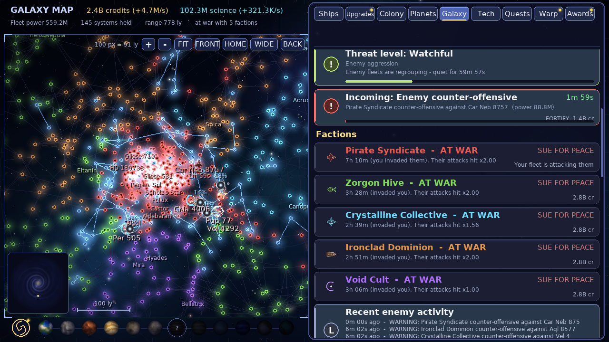

The Galaxy tab keeps a short log of recent enemy activity (and tells you when a system is lost), and the Stats page counts big raids repelled, counter-offensives held and systems lost / retaken.

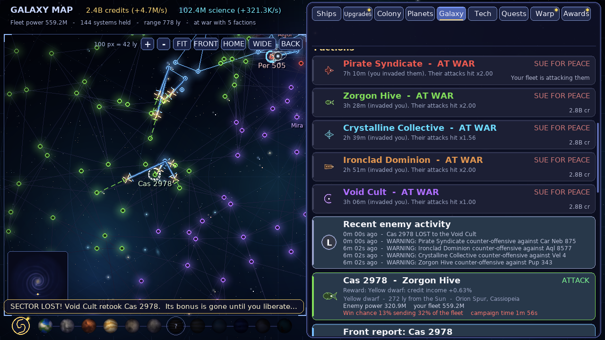

The balancing bot (which buys Intel, Fortifies bad fights and keeps its fleet up) still loses a few systems over a long game - about one in thirty - and retakes some of them; a player who ignores their defences loses many more.

The first fifteen famous places - the original sectors of the game, with their original strength - and their rewards:

| # | System | Real place | Reward for liberating it |
|---|---|---|---|
| 1 | Oort Cloud | The comet cloud at the edge of the solar system | Ships 5% cheaper everywhere |
| 2 | Alpha Centauri | 4.4 ly | All production x1.3 |
| 3 | Barnard's Star | 6.0 ly | Credit income x2 |
| 4 | Wolf 359 | 7.9 ly | Fleet power x1.5 |
| 5 | Sirius | 8.6 ly | Science income x2 |
| 6 | Epsilon Eridani | 10.5 ly | All production x1.5 |
| 7 | Tau Ceti | 11.9 ly | Crates 50% more often, pay x2 |
| 8 | Vega | 25 ly | Dark Matter gain x1.25 |
| 9 | Procyon | 11.5 ly | Clicks x10 |
| 10 | Altair | 16.7 ly | All production x2 |
| 11 | Betelgeuse | 550 ly | Ships 10% cheaper everywhere |
| 12 | Orion Nebula | 1,340 ly | Dark Matter gain x1.5, fleet power x1.5 |
| 13 | Crab Nebula | 6,500 ly | All production x2 |
| 14 | Galactic Core | 25,800 ly | All production x3, fleet power x2 |
| 15 | The Void Throne | Sagittarius A*, 26,670 ly | All production x5, Stardust gain x1.5  -  the final boss |

More of the sky's famous places give smaller rewards: Proxima Centauri (clicks), Fomalhaut (crates), Arcturus, Capella, Rigel, Deneb, the Pleiades, Tabby's Star, the Vela Pulsar, Cygnus X-1, Eta Carinae, Westerlund 1, Omega Centauri, Cassiopeia A and many more.

### 8. Warp (prestige)

When progress slows down, open the **Warp** tab. Warping resets the ore, ships and upgrades on every planet, but you keep your unlocked planets, colonies, megaprojects, techs, credits, science and **Dark Matter**.

- Dark Matter total = (ore mined this cycle / 1 billion) ^ 0.25, so you earn it from everything you mine, not just the last run.
- Your Dark Matter gives a permanent production bonus of `1 + 0.4 x sqrt(Dark Matter)`.
- You can also *spend* Dark Matter on 22 perks (all production x2, x3 or more, offline progress at 100%, faster travel, bigger starting supplies...).


A good rule of thumb: warp when the "Warp now for" number is at least as big as the Dark Matter you already own.

### 9. Ascension (New Game+)

Once you have defeated **The Devourer** on the Void Throne the *Ascension* section of the **Warp** tab unlocks. **Ascending** starts a brand-new **cycle** (New Game+): the whole universe resets - your planets, ships, colonies, tech, credits, science, Dark Matter, armory, liberated sectors and megaprojects are gone - but you keep:

- all your **achievements** (and their production bonus) and statistics, and
- **Stardust**, a new permanent currency you earn every time you Ascend.


Stardust does two things:

1. Your total Stardust gives a permanent **production bonus** (`1 + 0.4 x sqrt(Stardust earned)`).
2. You can spend it on **Stardust perks**: start every cycle with extra planets already unlocked, cheaper tech, big production and fleet-power multipliers, and - most importantly - perks that let you **keep** megaprojects, armory levels and liberated sectors when you Ascend. Each Ascension also earns about 10% more Stardust than the last.


The price of going again: in cycle *n* planets and megaprojects cost more (`1 + 10 x (n - 1)` times the original price) and enemy fleets are 1.25x stronger per cycle. Even so, the first New Game+ cycle takes roughly half as long as the first run, and later cycles settle at about 55 - 65 hours each in the balancing bot's runs. The current cycle is shown in the top-left corner and on the Stats page.


| Perk | Stardust | Effect |
|---|---|---|
| Colonial Charter | 6 | Every cycle starts with the Moon unlocked |
| Settlers' Fleet | 24 | Every cycle starts with 3 extra planets unlocked |
| Founding Fathers | 80 | Every cycle starts with 5 extra planets unlocked |
| Empire Seeds | 300 | Every cycle starts with 7 extra planets unlocked |
| Echoes of Wisdom | 12 | Techs cost 30% less |
| Deep Memory | 50 | Techs cost 50% less |
| Eternal Reactors | 16 | All production x2 |
| Cosmic Dust | 60 | All production x3 |
| Singularity Seed | 200 | All production x5 |
| Primordial Light | 800 | All production x10 |
| Legacy Wonders | 40 | Keep your first 4 megaprojects when you Ascend |
| Wonder Archive | 240 | Keep your first 8 megaprojects when you Ascend |
| Eternal Wonders | 1000 | Keep all 12 megaprojects when you Ascend |
| War Machine | 30 | Fleet power x3 |
| Void Fleet | 400 | Fleet power x10 |
| Time Dilation Engine | 20 | Offline progress at 100% |
| Stardust Siphon | 100 | Stardust gain x1.5 |
| Quantum Keys | 120 | Start every cycle with 1,000 Dark Matter |
| Armory Archive | 90 | Keep your armory upgrades when you Ascend |
| Galactic Charter | 500 | Keep your 25 nearest liberated systems when you Ascend |
| Stellar Dominion | 1600 | Keep your 100 nearest liberated systems when you Ascend |

### 10. Achievements

There are **200 achievements** in 12 categories: Mining, Fleet, Planets, Colony, Projects, Science, Wealth, Quests, Warp, Galaxy, General and a handful of **Secret** ones whose name and description stay hidden until you earn them.

- Every achievement has a **tier** - bronze (+0.5% production), silver (+1%), gold (+2%) or platinum (+4%) - so completing everything is worth roughly **+200%** to all production.
- The **Awards** tab shows a **progress bar** for every unfinished achievement, sorted so the ones closest to done are at the top. Use the category chips to filter.
- A banner slides in when you unlock one, and the Awards tab shows a dot when something new arrived.


### 11. Stats and settings

The **Stats** chip in the Awards tab lists everything you have done (play time, clicks, ore mined, trips, warps, Dark Matter...) and has the settings: **sound on/off**, **volume**, **fullscreen**, the **size** (resolution) of the game, **save now** and **hard reset**.


The settings are at the bottom of the page: sound, the **Fullscreen** button (the same as **F11**), the **Size** button (the resolution, see above), saving, and **Open log folder** (see Troubleshooting):


Sound effects (clicks, purchases, unlocks, crates, achievements, travel and warp) are synthesised by `sounds.py`, so there are no audio files. If there is no audio device the game just stays silent.

## Developer mode

Developer mode adds a **Dev** tab full of cheats for testing and balancing. It can **only** be switched on from the terminal - there is no in-game way to enable it:

```sh
./play.sh --dev
# or
python3 space_miner.py --dev
```

Press **F1** to jump to the Dev tab and back. A red `DEV MODE` badge shows in the corner while it is on.


| Section | What you can do |
|---|---|
| Time | Skip +1 hour / +1 day / +30 days of production, game speed x1 / x5 / x20 / x100 |
| Resources | Add or multiply ore, credits, science and Dark Matter, **infinite resources**, **god mode** (production x1000), clear everything |
| Planets | Unlock the next planet, unlock all the solar planets, settle the worlds of the stars you hold (free), relock all but Earth |
| Fleet & upgrades | Give ships to this planet or all planets, every upgrade for free |
| Colonies & megaprojects | Max every building, build one or all megaprojects |
| Tech, perks & quests | Research everything, grant or reset every Dark Matter perk, complete or reroll quests |
| Events & crates | Trigger any of the 9 random events, spawn a supply crate, start a Mining Frenzy |
| Galaxy & enemies | Liberate the weakest reachable system / 25 / 250 / every system, liberate the Void Throne, max the Jump Drive, max the Command track, earn every general and warden, promote the generals, resume paused ones, finish or force-win every running campaign, max the armory (and Intel), declare war on everyone / make peace / push a faction to invade, trigger raids you win or lose, summon a small / regional / system raid or a counter-offensive (arrives in seconds), resolve or clear all incoming attacks, lose a sector, anger every faction, skip the enemy's grace period |
| Ascension (New Game+) | Add Stardust, force an Ascension, grant or refund every Stardust perk |
| Achievements & warp | Unlock or lock every achievement, force a warp |
| Game | Save, reload from disk, wipe the save, show an FPS counter |

Using any cheat marks the save as cheated: the Stats page says so and you earn the secret *Caught in the Act* achievement. Run `python3 space_miner.py --help` for the flags.

## Late game

Later on you will be juggling a dozen planets, each with its own ore and fleet. This is what the endgame looks like on Saturn:


### Pacing

The pacing (planets, megaprojects and the march to the Galactic Centre) was tuned with a bot that plays the game headless (see below). A player who checks in every few minutes should reach roughly:

| Milestone | Roughly after |
|---|---|
| Moon | 12 minutes |
| Mars | 45 minutes |
| Venus | 1.5 - 3 hours |
| Mercury | 3 - 8 hours |
| Ceres / Jupiter | 5 - 17 hours |
| Saturn / Uranus | 15 - 33 hours |
| Neptune / Pluto | 25 - 55 hours |
| Kuiper Belt | 25 - 45 hours |
| Every megaproject built | 50 - 100 hours |
| The final boss (Void Throne) | 45 - 70 hours |
| First Ascension, then every later cycle | after the boss; cycles of ~40 - 65 hours |

Enemy raids and counter-offensives are included in these numbers (the bot defends itself with Intel and Fortify); small raids that get through only cost a little ore. Warping a few times along the way speeds this up a lot. Playing less often just means the numbers go up while you are away.

## Tips

- Early on, click a lot - clicks are strong until your first few ships. Buy a Habitat Dome and a Research Lab on Earth as soon as you can afford them: Credits and Science unlock the tech tree.
- Don't spend everything. Unlocking the next planet needs a big stockpile of the previous planet's ore, so stop buying ships on it once the progress bar is close.
- Visit new planets right after unlocking them: clicking there bootstraps a fleet quickly, and each planet bonus helps every other planet.
- Research *Auto-Drones* and *Auto-Engineers* early and the game mostly plays itself while you travel.
- Zoom into your fronts (**Z**): systems with red *Vulnerable* shields are the ones the enemy will take back, so Fortify them when an attack is announced - or raise the defence share and put a *Fortress* posture on that region.
- Check the Galaxy tab every so often: a glowing dot appears on it when a manual campaign slot is free and a campaign has a good win chance. Liberating systems is one of the biggest production boosts in the game.
- Liberate Alpha Centauri first: it earns your first **general**. Give it a heading and let it run; add generals as you earn them, and keep the defence share high enough that a lost system stays rare. Before the final assault on the Void Throne, set the defence and the armies low so the whole fleet goes.
- After the boss, Ascend: spend the Stardust on the planet-starting perks and the "keep" perks first - they make every later cycle much faster.
- Put credits and science into the Armory (Weapons first) - your win chances jump quickly, and Armor makes failed campaigns cheaper.
- Peace is yours to break: stay at peace while you build up and invade when you are ready - but the factions on your border will not wait for ever, so keep an eye on their tension bars. A ceasefire is cheap once a war has dragged on.
- Build Defense Grids on planets that keep getting raided, and buy a few levels of Intel: with the target named you can Fortify it and turn a lost raid into a won one.
- Don't let your fleet fall far behind the enemy next to you: that is what makes the Threat Director aggressive. Attacking one faction over and over also makes it hit back harder.
- Open the Awards tab now and then: the nearest-to-done achievements sit at the top and every one is a permanent production bonus.
- If a dot is glowing on a tab, there is something affordable in it.

## Project layout

| File | What it is |
|---|---|
| `space_miner.py` | The game window, input and all the UI |
| `core.py` | Game rules, state, the galaxy / combat model and the achievement list. No pygame in here, so it runs headless |
| `director.py` | The Threat Director: aggression, raid and counter-offensive scheduling, Intel warnings, Fortify. No pygame either |
| `generals.py` | The generals and wardens: command systems, orders and target choice, armies, the defence pool and postures. No pygame either |
| `front.py` | The frontline model: where each battle line sits, status of a front, garrison and hold chances. No pygame either |
| `frontview.py` | The zoomable galaxy view: camera, mini-map, fleets and battle lines |
| `touch.py` | Touch input: taps, drag-to-scroll with momentum, pinch to zoom the galaxy map |
| `main.py`, `buildozer.spec` | The Android entry point and build settings |
| `devtools.py` | The developer-mode cheats (only reachable with `--dev`) |
| `sounds.py` | Procedural sound effects |
| `gfx.py` | Procedural graphics: planets, asteroids, Earth's classic ships, backdrops, the painted Milky Way |
| `shipart.py` | The ships of the other eleven planets (a hull family each) and their mining lasers |
| `ships.py` | The twelve per-planet ship rosters: names, descriptions, colours and how the ships fly. No pygame |
| `galaxy.py` | The Milky Way the galaxy map is played on: every system's power and reward, the lanes, the jump range and the reach map. No pygame |
| `worlds.py` | The planets of the other star systems: real ones from the Open Exoplanet Catalogue, generated ones for the rest, their kinds and the achievements they bring. No pygame |
| `colonies.py` | Colony worlds: turns any world into a planet you can settle (tier from the strength of its star, ore, bonus, ship family) and holds the balance numbers. No pygame |
| `worldview.py` | The *Colonies* and *All worlds* pages of the Planets tab and the worlds line of the map's bar |
| `milkyway.py` | The shape of the galaxy (spiral arms, bar, bulge) used to place the systems and to paint the map. No pygame |
| `sim.py` | A greedy bot that plays the game headless and prints a pacing timeline |
| `calibrate.py` | Searches for planet, megaproject and enemy-strength values that hit a target timeline using the bot |
| `version.py` | The version number |
| `resources.py` | Where bundled files, the save file and the logs live (also inside the Linux build) |
| `gamelog.py` | Logging, crash reports and the native-crash dump |
| `assets/` | The bundled DejaVu Sans font (with its license), the app icon, `galaxy.json` (the star systems) and `worlds.json` (the real planets of the real stars) |
| `packaging/` | `build_linux.sh` (the release build), the installer and the menu entry |
| `tools/` | `make_icon.py` (draws the icon), `fuzz.py` (random-input crash hunting), `ship_sheet.py` (a contact sheet of every ship) `make_worlds.py` (rebuilds `assets/worlds.json` from the Open Exoplanet Catalogue) and `make_galaxy.py` (rebuilds `assets/galaxy.json`: the real stars and the generated systems) |
| `CHANGELOG.md`, `.github/workflows/` | Release notes; CI (self-test on every push) and the release workflow |
| `play.sh` | Launcher that installs pygame if needed |
| `screenshots/` | Images used in this README |

### Balancing tools

```sh
python3 sim.py hours=100 interval=120        # bot checks in every 2 minutes for 100 simulated hours
python3 sim.py hours=100 interval=900 quiet=1 # only print unlocks and megaprojects
python3 sim.py hours=400 interval=120 quiet=1   # also ascends and spends Stardust: look for the ASCEND lines
python3 calibrate.py interval=120             # re-derive unlock/project values (takes an hour or so)
python3 tools/fuzz.py frames=5000 seed=7      # random clicks, drags, scrolls and keys in several game states; lists any crash
```

The knobs live in `core.py` (`UNLOCK_LOG`, `PROJECT_LOG`, `SECTOR_LOG`, `TUNE` - including `cdiff`, `cpow` and `sdcoef` for New Game+).

### Making a release

1. Bump `__version__` in `version.py` and add a section for it to `CHANGELOG.md`.
2. `./packaging/build_linux.sh` builds `dist/space-miner-<version>-linux-<arch>.tar.gz` (with a `.sha256`) on your machine: a one-file executable made with PyInstaller, the installer, the icon and the docs.
3. For a published release, push a tag: `git tag v1.0.1 && git push origin v1.0.1`. The *Release* workflow runs the self-test, builds the files and creates the release on the Releases page, using the changelog section as the notes. You can also publish without a tag: *Actions -> Release -> Run workflow*, tick **publish** (it builds the branch you name, default `main`, and creates the release `v<version>` for you). The *CI* workflow runs the self-test on every push and pull request.

### Self-test

`python3 space_miner.py --selftest` runs the game headless for a few seconds and exercises buying, unlocking, travelling, events, quests, warping and saving. It writes a few `shot_*.png` images next to the script and uses a temporary save, so it never touches your real one. Add `--dev` to also fire every developer cheat once.

## Troubleshooting

- **Something went wrong or the game crashed** - the game writes a log, so there is always a record of why. Look in `~/.local/state/space-miner/` (the Stats page has an **Open log folder** button):
  - `space-miner.log` - start-up details (version, system, graphics driver), saves and loads, warps, setting changes and every error with its full traceback and the state of the game at that moment. It keeps the last few megabytes.
  - `crash-<date>.txt` - written when the game has to stop; it has the error, the system details and the end of the log.
  - `faulthandler.log` - a stack dump if the program dies for a reason Python cannot catch (a crash inside the graphics library, for example).

  An error in one frame is logged and the game carries on, and the Stats page shows how many errors were logged this session. If you report a bug, please attach `space-miner.log` and any `crash-*.txt`. Run with `--debug` for more detail.
- **My save is gone or broken** - a backup (`~/.space_miner_save.json.bak`, refreshed every 10 minutes) is used automatically if the save is damaged, and a save that cannot be read is never overwritten silently: a copy named `.unreadable-<date>` or `.broken-<date>` is kept next to it.

- **`ModuleNotFoundError: No module named 'pygame'`** - run `pip install pygame` (or use `./play.sh`).
- **No window appears over SSH / in a container** - the game needs a display. Run it from a desktop session.
- **The window is bigger than my screen / everything is tiny or huge** - choose another size with the **Size** button in the Stats page, or start with `--resolution 1280x720`. *Auto* normally picks a size that fits.
- **The window is small / fullscreen does not work** - the game needs a desktop session with a graphics renderer for the resizable, scaled window; otherwise it falls back to a fixed 1280x720 window and the Fullscreen button is greyed out. Try running it under X11 or Wayland (not over a plain SSH session), and make sure your graphics drivers are installed.
- **Text looks off** - the game asks for DejaVu Sans, Liberation Sans or Arial and falls back to pygame's default font.
- **Reset everything** - run `python3 space_miner.py --new-game` (it keeps a copy of the old save), or delete `~/.space_miner_save.json` (and `~/.space_miner_save.json.bak`), or use *Awards -> Stats -> Hard reset*.

