# Space Miner

An idle game for Linux, written in Python with [pygame](https://www.pygame.org). Start on Earth, mine the asteroids orbiting it, and expand across the whole solar system - and beyond. Every planet has its own ore, its own fleet, its own colony and its own bonus.

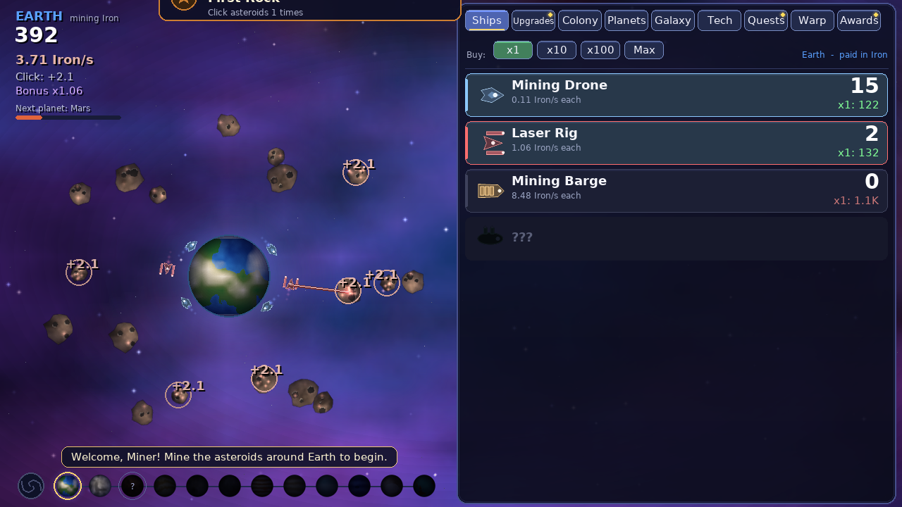

- **No assets, no dependencies except pygame** - every planet, ship, asteroid and effect is drawn by code at start-up.
- **Idle-friendly** - your fleets keep mining while the game is closed (up to 8 hours), and it autosaves every 15 seconds.
- **A lot of content** - 12 planets, 8 ship types per planet, 58 upgrades per planet, 6 colony buildings per planet, 12 megaprojects, 30 techs, 22 Dark Matter perks, 9 kinds of random events, rotating quests, a **galaxy map with 15 enemy-held sectors**, **New Game+ with Stardust** and **162 achievements**. Sound effects are generated by code too, and there is a developer mode for testing.

## Quick start

```sh
git clone https://github.com/notyourbusinessss/PasstimeLinuxGame.git
cd PasstimeLinuxGame
./play.sh
```

`play.sh` installs pygame if it is missing and starts the game. You need Python 3.9+ and a desktop session.
Prefer to do it by hand?

```sh
pip install pygame
python3 space_miner.py
```

On distros where pip refuses to install into the system Python ("externally managed environment"), use a virtual environment:

```sh
python3 -m venv venv
./venv/bin/pip install pygame
./venv/bin/python space_miner.py
```

Missing Python or pip? Debian/Ubuntu: `sudo apt install python3 python3-pip python3-venv` - Fedora: `sudo dnf install python3 python3-pip` - Arch: `sudo pacman -S python python-pip`.

## Controls

| Input | Action |
|---|---|
| Click an asteroid / **SPACE** | Mine ore |
| Click the planets along the bottom | Travel to an unlocked planet (or open the Planets tab for a locked one) |
| **1** - **9** | Switch panel tab (Ships, Upgrades, Colony, Planets, Galaxy, Tech, Quests, Warp, Awards) |
| **G** | Open / close the galaxy map |
| Mouse wheel over the galaxy map | Zoom in and out (towards the cursor) |
| Drag on the galaxy map | Pan the map |
| **+** / **-**, arrow keys | Zoom / pan the galaxy map from the keyboard |
| **Z**, or double-click a sector | Close look at the selected front (press **Z** again to zoom back out) |
| Mouse wheel over the panel | Scroll the list |
| Click a golden supply crate | Grab it before it drifts off |
| **0** / **F1** | Jump to the Dev tab (only in [developer mode](#developer-mode)) |
| **F11** or **Alt+Enter** | Toggle fullscreen |
| **Esc** | Leave fullscreen; in a window it quits (the game saves on exit) |

**Big screen.** The window is resizable: drag its edges, maximise it with your window manager, or press **F11** (or start with `./play.sh --fullscreen`). The whole game scales smoothly to fit, with black bars if the shape of your screen is different. On a large monitor it opens bigger than 1280x720 by itself, and the fullscreen setting is remembered.

Your save lives in `~/.space_miner_save.json`. Delete it (or use *Awards -> Stats -> Hard reset*) to start over.

## How the game works

### 1. Mine the asteroids

The planet you are visiting sits in the middle of the screen with asteroids orbiting it. Each click mines ore, shown in that planet's own ore type. Buy **ships** and they circle the planet, laser the asteroids and mine for you. Ships cost the same ore they mine, and each one gets pricier (+15%) than the last.

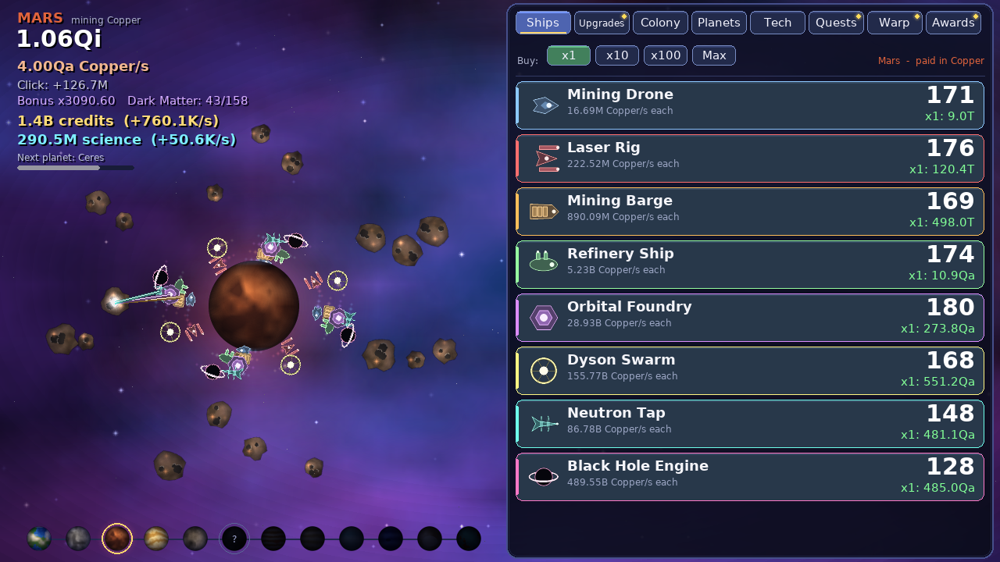

There are 8 ship types, from the humble Mining Drone to the Black Hole Engine. A new ship type shows up as `???` once you own the one before it.

| Ship | Base cost | Base ore/sec |
|---|---|---|
| Mining Drone | 15 | 0.10 |
| Laser Rig | 100 | 1 |
| Mining Barge | 1.1K | 8 |
| Refinery Ship | 12.0K | 47 |
| Orbital Foundry | 130.0K | 260 |
| Dyson Swarm | 1.4M | 1.4K |
| Neutron Tap | 20.0M | 7.8K |
| Black Hole Engine | 330.0M | 44.0K |

*(Costs and output are multiplied by 10 for every planet further out, so the first drone on the Moon costs 150 Silicon and mines 1 Silicon/sec, and on Mars 1.5K Copper and 10 Copper/sec.)*

### 2. Upgrades

The **Upgrades** tab lists what you can buy on the current planet with its ore: ship multipliers that unlock as you own more of a ship (x2, x2, x3, x3, x5), stronger clicks, drills that make each click also mine a share of your ore/sec, and *Star Charts* that boost the whole planet. **Buy everything affordable** is one click.

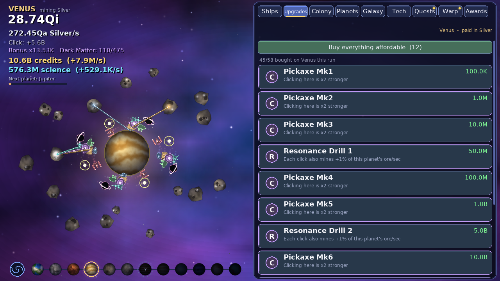

### 3. Unlock and travel to new planets

Open the **Planets** tab. The next planet is unlocked by paying ore from the worlds *behind* it - usually the previous planet's ore, plus a little of the one before that, plus credits later on. Unlocking gives you:

1. a **new ore** to mine on its own asteroids,
2. an empty **fleet, upgrade shop and colony** to build,
3. a permanent **planet bonus** that helps everywhere (clicks, cheaper ships, production multipliers, offline progress...).

Once a planet is unlocked, click it in the bottom strip (or the Planets tab) to fly there. A short hyperspace jump later you are mining a new ore. **Every unlocked planet keeps producing while you are somewhere else.**

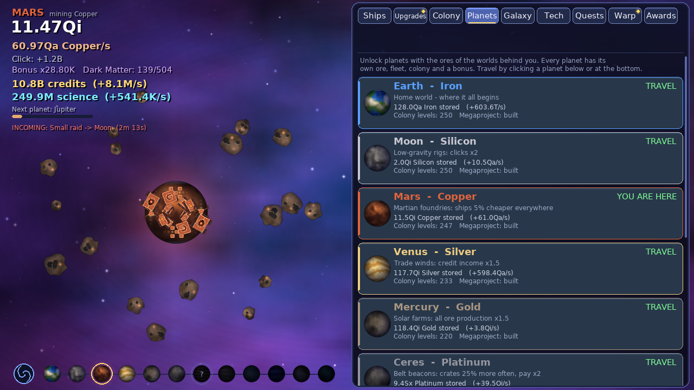

| # | Planet | Ore | Planet bonus |
|---|---|---|---|
| 1 | Earth | Iron | Home world - where it all begins |
| 2 | Moon | Silicon | Low-gravity rigs: clicks x2 |
| 3 | Mars | Copper | Martian foundries: ships 5% cheaper everywhere |
| 4 | Venus | Silver | Trade winds: credit income x1.5 |
| 5 | Mercury | Gold | Solar farms: all ore production x1.5 |
| 6 | Ceres | Platinum | Belt beacons: crates 25% more often, pay x2 |
| 7 | Jupiter | Helium-3 | Gas-giant labs: science income x2 |
| 8 | Saturn | Diamond | Ring-miners: ships 5% cheaper, clicks x2 |
| 9 | Uranus | Antimatter | Cold engines: all ore production x2 |
| 10 | Neptune | Dark Crystal | Deep-space drift: offline progress at 75% |
| 11 | Pluto | Exotic Matter | Edge of the system: Dark Matter gain x1.5 |
| 12 | Proxima b | Quantum Foam | Another star: all ore production x3, buildings x1.5 |

A "Next planet" progress bar in the top-left corner shows how close you are, and hovering a planet in the bottom strip lists exactly what it costs.

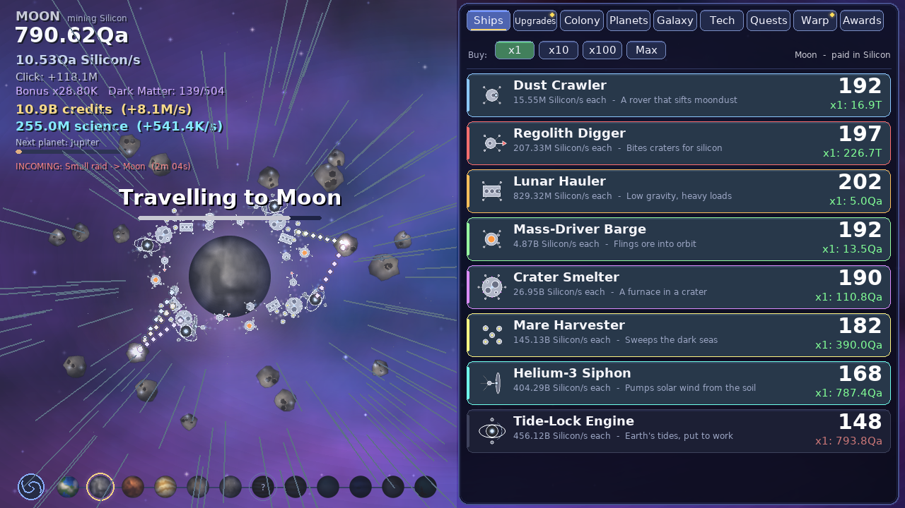

### 4. Colonies and megaprojects

The **Colony** tab lets you build on the current planet. Credits and Science, which you need for techs and megaprojects, come from here.

| Building | Paid in | What it does |
|---|---|---|
| Mining Complex | that planet's ore | +3% ore output here / level |
| Habitat Dome | that planet's ore | Produces Credits |
| Research Lab | that planet's ore | Produces Science |
| Shipyard | credits | -0.6% ship prices here / level |
| Fusion Reactor | credits | +2.5% ALL production / level |
| Defense Grid | science | +4% crate frequency, +10% defense vs raids / level |

Each planet gives a x2 boost to one building type (Proxima b boosts all of them x1.5), and buildings go up to level 50.

Every planet also has one **megaproject** at the bottom of its Colony tab. It costs a huge pile of that planet's ore *plus* credits and science, and it permanently boosts your whole empire - even through Warps. That is what makes the old ores worth keeping.

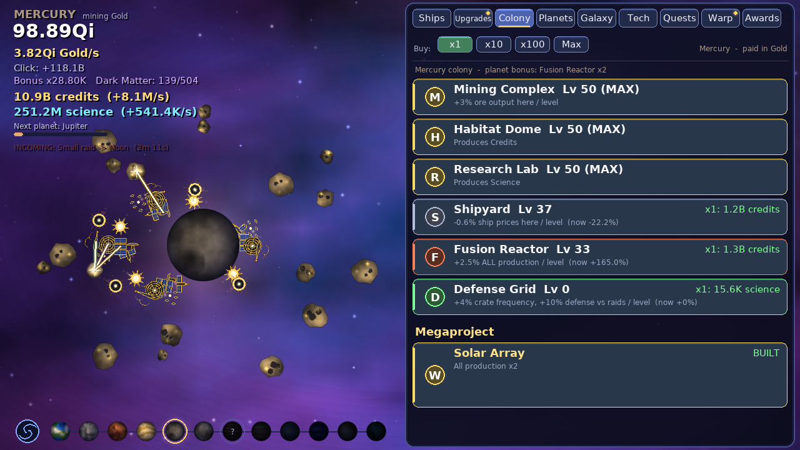

| Planet | Megaproject | Effect |
|---|---|---|
| Earth | Orbital Ring | Ships 10% cheaper everywhere |
| Moon | Lunar Mass Driver | All production x1.5 |
| Mars | Terraformers | All production x2 |
| Venus | Cloud Cities | Credit income x3 |
| Mercury | Solar Array | All production x2 |
| Ceres | Belt Network | Crates 50% more often, pay x2 |
| Jupiter | Gas Siphons | Science income x3 |
| Saturn | Ring Elevator | All production x2 |
| Uranus | Ice Forges | Ships 10% cheaper everywhere |
| Neptune | Deep Core Mine | All production x3 |
| Pluto | Edge Gate | Dark Matter gain x2 |
| Proxima b | Alpha Dyson Swarm | All production x5 |

### 5. Tech tree

Science buys the **Tech** tree: 30 techs with prerequisites. They include automatic ship buying and upgrade buying (they only ever spend up to 25% of a stockpile so you can still save for planets), automatic crate collection, big production multipliers, cheaper ships, head-start ore after a Warp and more. Techs stay forever.

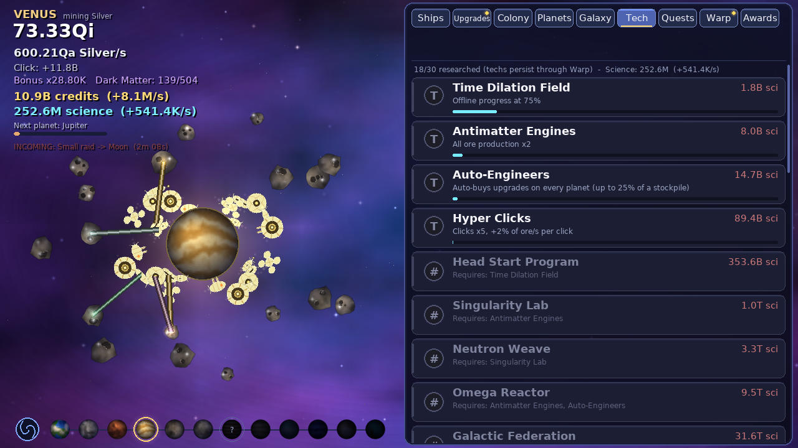

### 6. Quests, crates and random events

- **Quests** - three rotating goals (click asteroids, buy ships, mine ore, grab crates, upgrade colonies, resolve events...). Fill the bar and claim ore, credits, science or a Mining Frenzy.
- **Supply crates** - a golden crate drifts across the screen every minute or so. Grab it for ore, credits or a x7 *Mining Frenzy*.
- **Random events** - every few minutes something happens at the planet you are on: meteor showers, pirate raids, solar flares, a cosmic lottery, derelict ships, alien traders, research grants, distress signals and, very rarely, a whisper from the void. Most give you a risky option and a safe one.

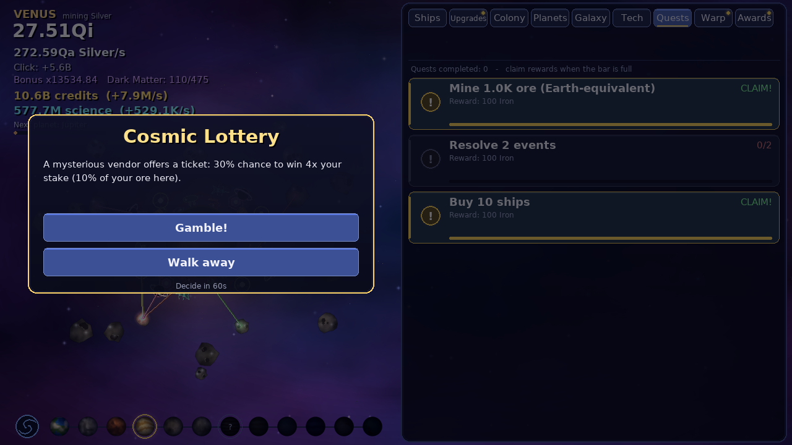

### 7. The galaxy: enemies, campaigns and raids

Once you unlock **Mars** the **galaxy map** opens (the spiral button at the far left of the planet strip, or press **G**). Beyond the solar system lie **15 sectors** held by hostile factions - Pirate Syndicate, Zorgon Hive, Crystalline Collective, Ironclad Dominion, Void Cult and, waiting on the far edge, the final boss **The Devourer**. Sectors you have not scouted yet stay hidden in the fog; you can only attack sectors that border territory you already hold.

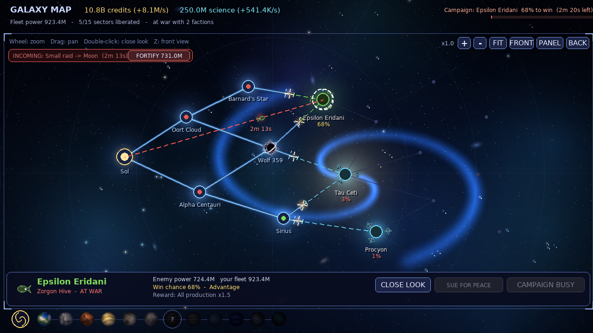

**Fleet power.** Your fleet's strength comes from the ships you own on all your planets (bigger ships count for far more), boosted by your Weapons upgrades, your Defense Grids, your overall production bonus and the sectors you have liberated. It is shown on the Galaxy tab.

**Campaigns.** Pick a frontier sector on the map or in the *Galaxy* tab and press **ATTACK**. Your fleet's power is committed and a campaign timer runs while you keep playing (or while the game is closed). When it ends the game rolls the dice using the win chance shown beforehand (it depends on your fleet power compared with the enemy's):

- **Victory** - the sector is liberated and its **permanent bonus** is yours (they survive Warps), and you lose about 1% of your ships.
- **Defeat** - you lose about 8% of your ships and can try again once you are stronger.

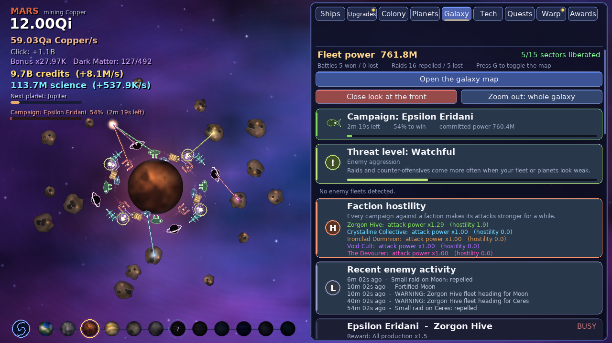

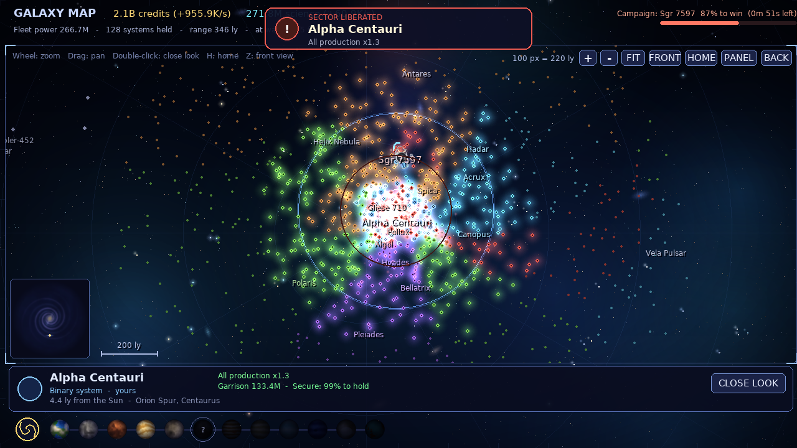

#### Close look: the frontlines

The galaxy map is a zoomable tactical view. Scroll the **mouse wheel** to zoom towards the cursor, **drag** to pan (or use **+** / **-** and the arrow keys), and use the buttons in the corner: **+**, **-**, **FIT** (the whole galaxy) and **FRONT** (zoom in on the front of the selected sector - **Z** and a double-click on a sector do the same). A mini-map shows where you are once you zoom in, and you can click it to jump somewhere else.

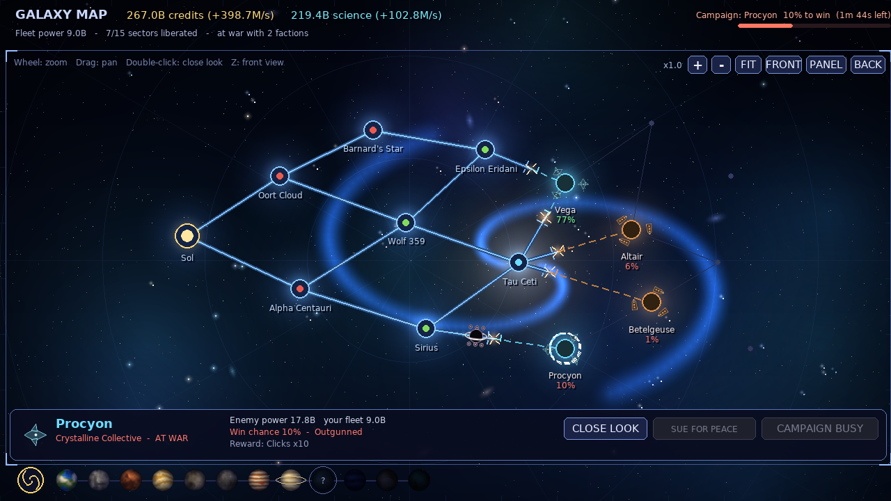

Every lane between a sector of yours and an enemy sector is a **front**. The battle line sits where the two forces balance: the stronger your fleet is compared with that sector's defenders, the closer to the enemy the line is pushed, and a running campaign pushes it further. Zoomed out you see a clash marker on each front; zoom in and the front turns into a battle:

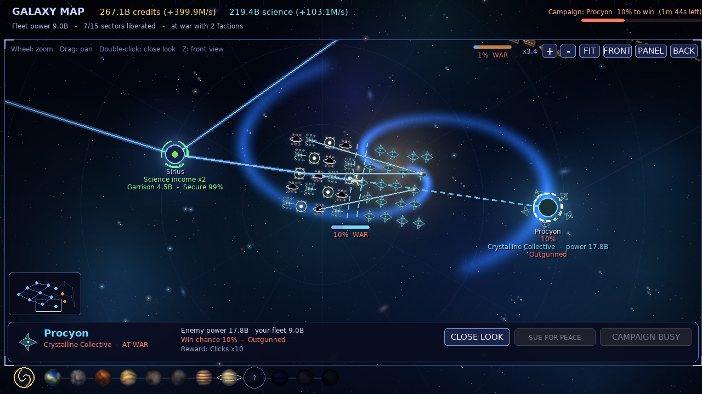

- **Both fleets** are drawn as swarms facing each other across the battle line. The more power, the bigger the swarm; your ships are the types you actually own, the enemy's are its faction's ships. Lasers and explosions fly while the fight goes on.
- **Power split.** A small bar at each front shows your share of the combined strength and your win chance.
- **Labels** fill in as you zoom: the enemy sector's faction, power and a status (*Dominating*, *Advantage*, *Stalemate*, *Under pressure* or *Outgunned*), and for your own sectors their reward.
- **Garrison shields.** Every sector of yours that borders the enemy wears shield arcs, coloured by how likely it is to hold against a counter-offensive: green *Secure* (80% or more), yellow *Holding* (50% or more), red *Vulnerable*. Fortifying a sector against an incoming attack gives it a gold ring.
- **Incoming attacks** (with the Intel upgrade) appear as an enemy fleet sailing down the lane with a countdown, so you can watch a counter-offensive arrive and see exactly which sector it is aimed at.

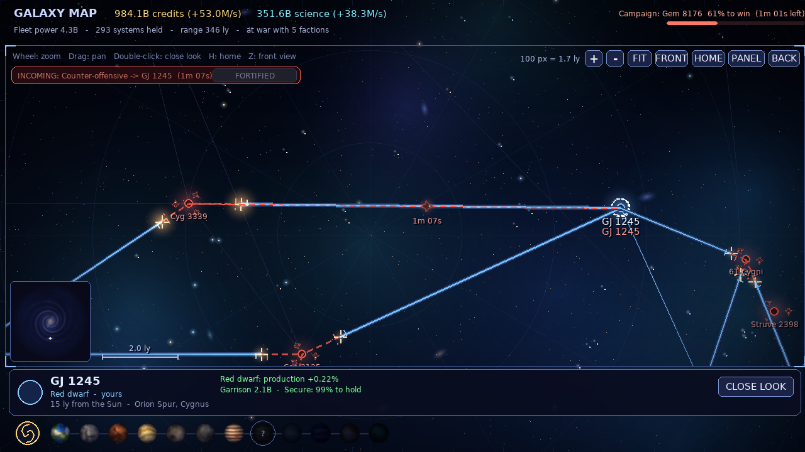

The **Galaxy tab** has **Close look at the front** and **Zoom out** buttons and a **Front report** card for the selected sector: the status of the fighting, the power split, where an attack would launch from and which sectors border it - or, for a sector you hold, its garrison, which enemies can reach it and its chance to hold. Clicking the card (or a sector in the list) takes the map there.

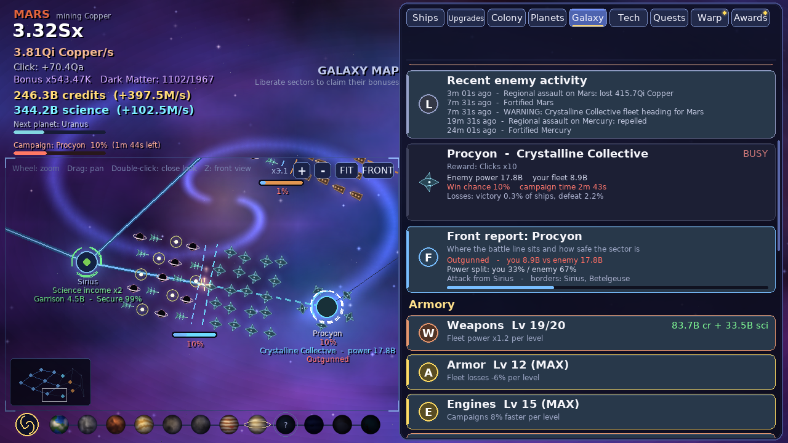

**Armory.** Credits and Science buy permanent military upgrades:

| Upgrade | Max level | Effect |
|---|---|---|
| Weapons | 20 | Fleet power x1.2 per level |
| Armor | 12 | Fleet losses -6% per level |
| Engines | 15 | Campaigns 8% faster per level |
| Shields | 10 | Raid losses -8% per level |
| Intel | 8 | Enemy attacks are announced earlier and in more detail (see *The Threat Director* below) |

**Raids.** While enemy sectors border your territory they **raid your planets**. Your ships and **Defense Grid** buildings (+10% defense per level) fight them off: you get credits for repelling a raid, or lose some of that planet's ore if the defence fails. If you are on the raided planet you watch it happen:

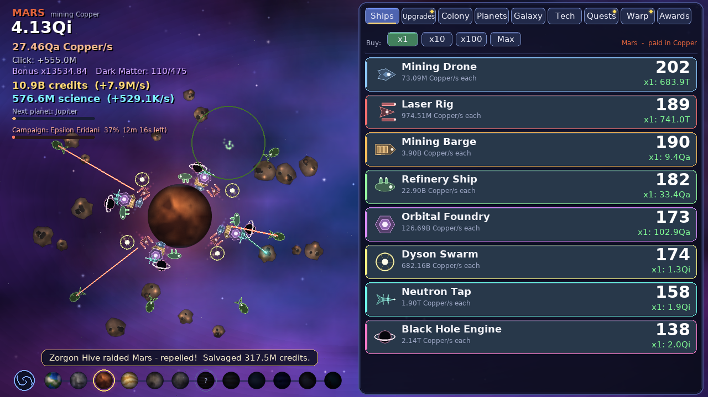

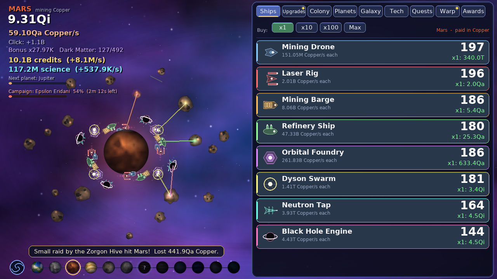

#### The Threat Director

The enemy is not random: a **Threat Director** watches how strong you are compared with the enemy sectors that border you and decides when to strike. The Galaxy tab shows its **Threat level** card:

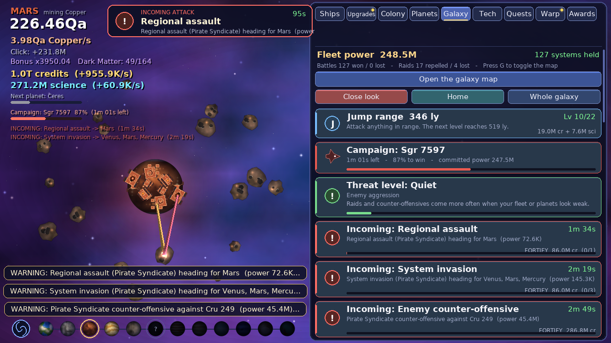

- **Aggression** (Quiet, Watchful, Hostile, Aggressive, Warlike) rises when your fleet is weak next to the nearest enemy, when some of your planets are poorly defended and when you have been attacking a faction recently. The more aggressive the enemy, the more often it attacks.
- **Raids** hit your planets, and the enemy prefers the weakly defended ones. They come in three sizes:

| Raid | Appears once you hold | Power | Planets hit | If you hold | If you lose |
|---|---|---|---|---|---|
| Small raid | - | x1 | 1 | credits | 4% of that planet's ore |
| Regional assault | 3 sectors | x3 | 1 | 4x the credits | 10% of that planet's ore |
| System invasion | 8 sectors | x6 | 3 at once | 10x the credits | 14% of each planet's ore |

  Your Shields upgrade reduces what a lost raid costs.
- **Counter-offensives** try to **retake a sector you liberated** that borders enemy territory. Each sector is defended by its **garrison** (your fleet power when you took it, never less than half your current fleet). If it falls you lose that sector's permanent bonus until you liberate it again (which earns the *Comeback* achievement).
- **Hostility.** Every campaign you start angers the faction you attack: its raids and offensives hit up to 2x harder, and the anger fades over a couple of hours.
- **Grace periods.** The enemy never attacks while the game is closed, and stays quiet for 10 minutes after you load a save, 15 after a Warp and 20 after an Ascension.

**Intel** decides how much you know in advance. Each level adds warning time (raids: 15 s + 45 s per level, counter-offensives: 60 s + 100 s per level), and higher levels reveal more:

| Intel level | You are told |
|---|---|
| 0 | Nothing: the raiders just arrive |
| 1 - 2 | "Unknown ships detected" |
| 3 - 4 | Who is coming and which planet or sector is the target, and you can Fortify it |
| 5 - 6 | ...plus the attack's power |
| 7 - 8 | ...plus your exact chance to hold |

Incoming attacks show up on the HUD and as a dashed red lane on the galaxy map, each with a countdown:

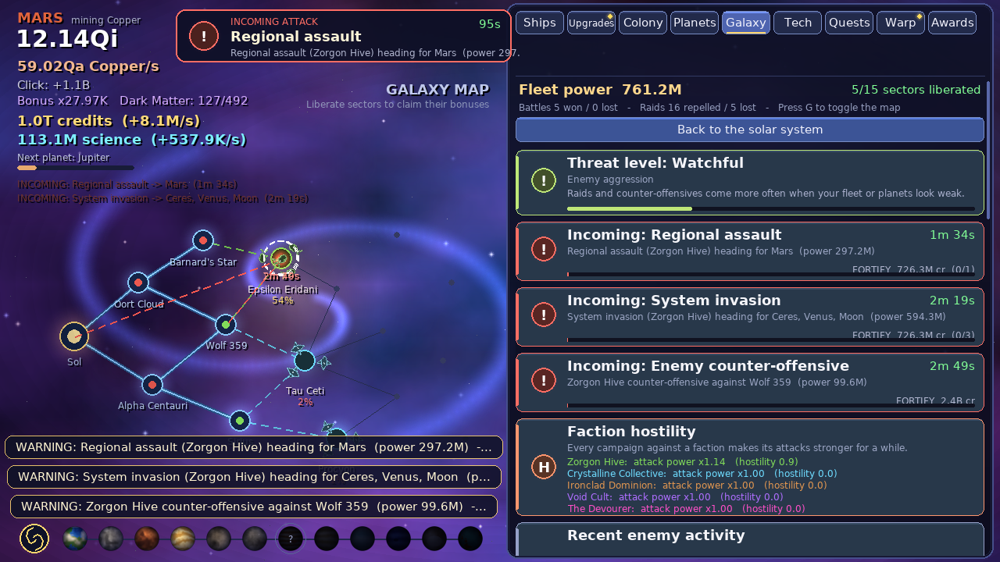

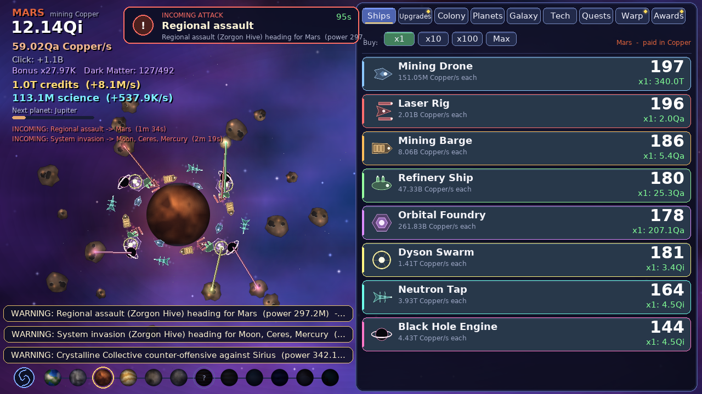

With Intel 3 or more you can press **Fortify** on an incoming attack. It costs credits and multiplies the defence of the target (x2.5 for a planet, x2 for a sector) for that one attack.

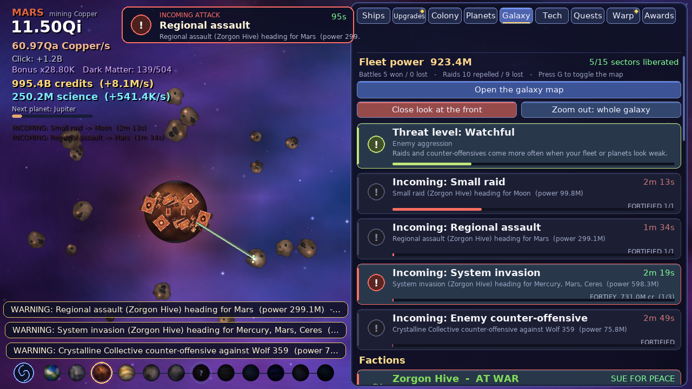

A System invasion is a proper swarm:

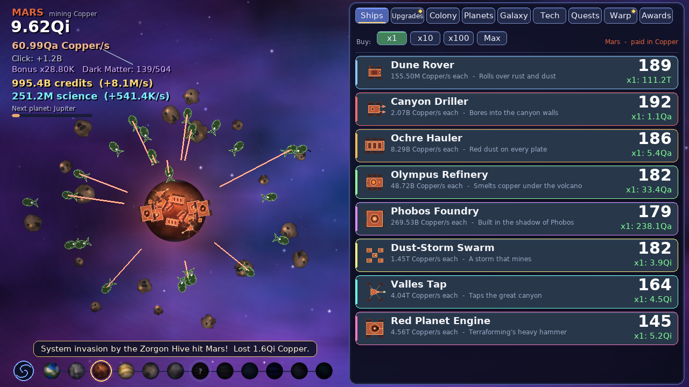

And when a sector falls, the galaxy map says so:

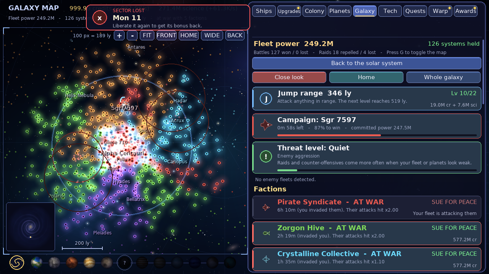

The Galaxy tab keeps a short log of recent enemy activity, and the Stats page counts big raids repelled, counter-offensives held and sectors lost / retaken. The balancing bot (which buys Intel, Fortifies bad fights and keeps its fleet up) loses no sectors, but a player who ignores their defences will.

The 15 sectors and their rewards (each liberated sector also weakens the next raids):

| # | Sector | Faction | Reward for liberating it |
|---|---|---|---|
| 1 | Oort Cloud | Pirate Syndicate | Ships 5% cheaper everywhere |
| 2 | Alpha Centauri | Pirate Syndicate | All production x1.3 |
| 3 | Barnard's Star | Pirate Syndicate | Credit income x2 |
| 4 | Wolf 359 | Zorgon Hive | Fleet power x1.5 |
| 5 | Sirius | Zorgon Hive | Science income x2 |
| 6 | Epsilon Eridani | Zorgon Hive | All production x1.5 |
| 7 | Tau Ceti | Crystalline Collective | Crates 50% more often, pay x2 |
| 8 | Vega | Crystalline Collective | Dark Matter gain x1.25 |
| 9 | Procyon | Crystalline Collective | Clicks x10 |
| 10 | Altair | Ironclad Dominion | All production x2 |
| 11 | Betelgeuse | Ironclad Dominion | Ships 10% cheaper everywhere |
| 12 | Orion Nebula | Ironclad Dominion | Dark Matter gain x1.5, fleet power x1.5 |
| 13 | Crab Nebula | Void Cult | All production x2 |
| 14 | Galactic Core | Void Cult | All production x3, fleet power x2 |
| 15 | The Void Throne | The Devourer | All production x5, Stardust gain x1.5  -  the final boss |

### 8. Warp (prestige)

When progress slows down, open the **Warp** tab. Warping resets the ore, ships and upgrades on every planet, but you keep your unlocked planets, colonies, megaprojects, techs, credits, science and **Dark Matter**.

- Dark Matter total = (ore mined this cycle / 1 billion) ^ 0.25, so you earn it from everything you mine, not just the last run.
- Your Dark Matter gives a permanent production bonus of `1 + 0.4 x sqrt(Dark Matter)`.
- You can also *spend* Dark Matter on 22 perks (all production x2, x3 or more, offline progress at 100%, faster travel, bigger starting supplies...).

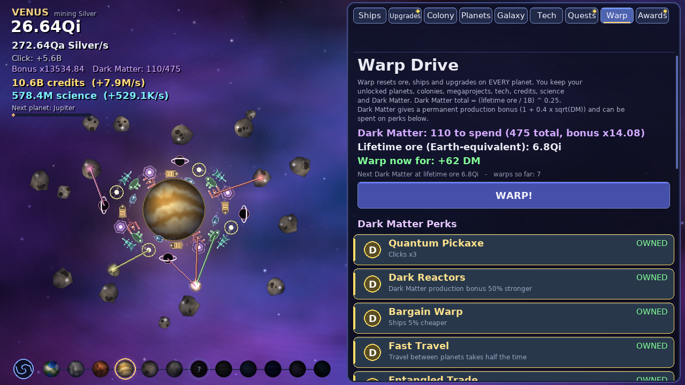

A good rule of thumb: warp when the "Warp now for" number is at least as big as the Dark Matter you already own.

### 9. Ascension (New Game+)

Once you have defeated **The Devourer** on the Void Throne the *Ascension* section of the **Warp** tab unlocks. **Ascending** starts a brand-new **cycle** (New Game+): the whole universe resets - your planets, ships, colonies, tech, credits, science, Dark Matter, armory, liberated sectors and megaprojects are gone - but you keep:

- all your **achievements** (and their production bonus) and statistics, and
- **Stardust**, a new permanent currency you earn every time you Ascend.

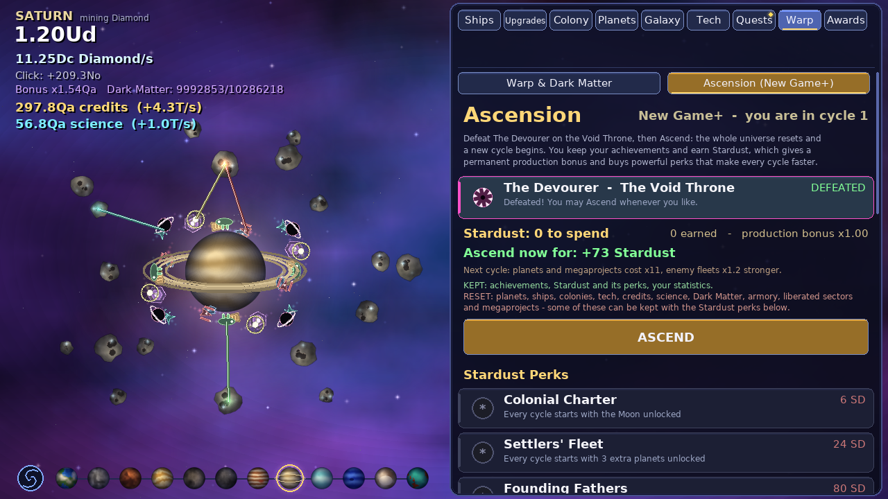

Stardust does two things:

1. Your total Stardust gives a permanent **production bonus** (`1 + 0.4 x sqrt(Stardust earned)`).
2. You can spend it on **Stardust perks**: start every cycle with extra planets already unlocked, cheaper tech, big production and fleet-power multipliers, and - most importantly - perks that let you **keep** megaprojects, armory levels and liberated sectors when you Ascend. Each Ascension also earns about 10% more Stardust than the last.

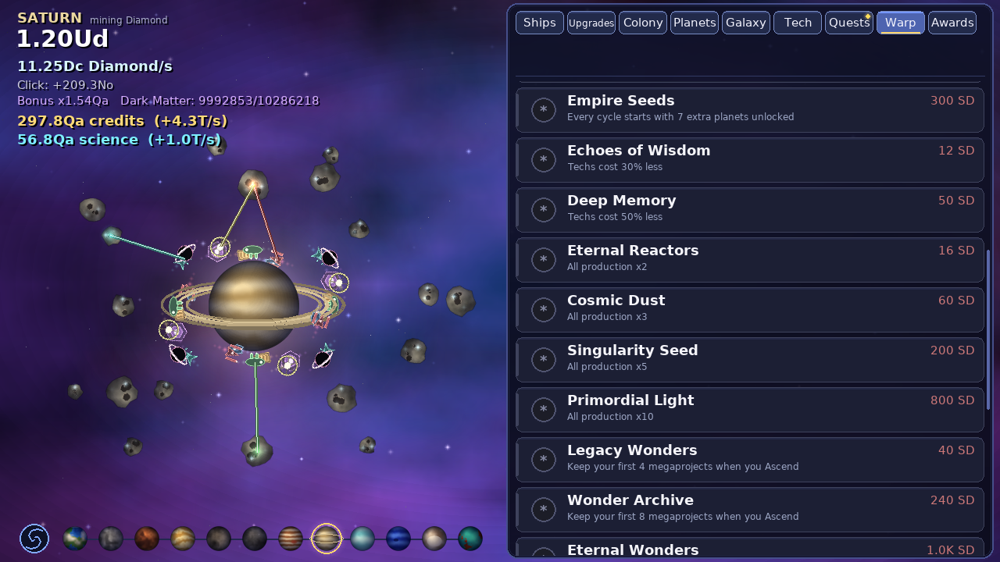

The price of going again: in cycle *n* planets and megaprojects cost more (`1 + 10 x (n - 1)` times the original price) and enemy fleets are 1.25x stronger per cycle. Even so, the first New Game+ cycle takes roughly half as long as the first run, and later cycles settle at about 55 - 65 hours each in the balancing bot's runs. The current cycle is shown in the top-left corner and on the Stats page.

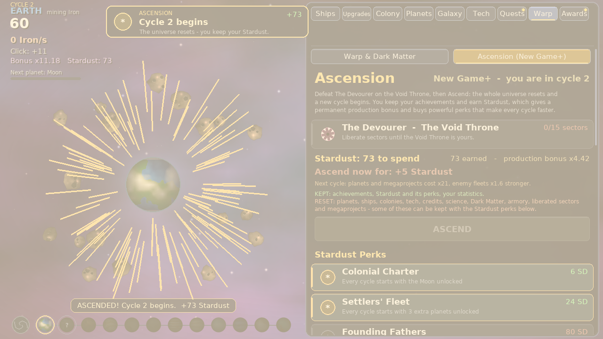

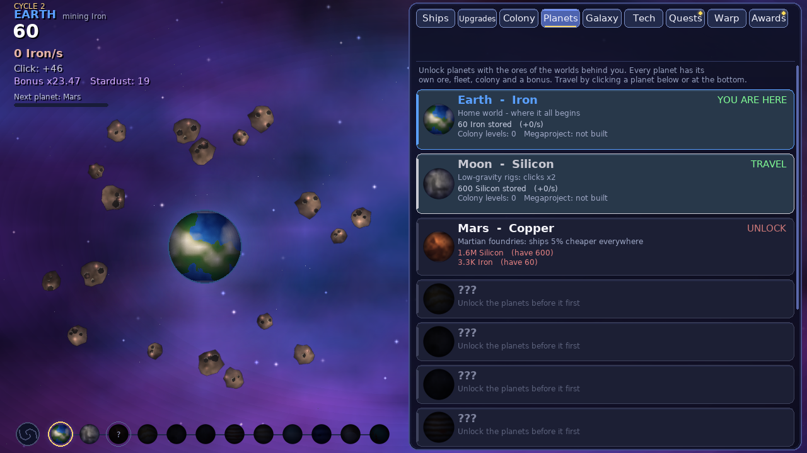

| Perk | Stardust | Effect |
|---|---|---|
| Colonial Charter | 6 | Every cycle starts with the Moon unlocked |
| Settlers' Fleet | 24 | Every cycle starts with 3 extra planets unlocked |
| Founding Fathers | 80 | Every cycle starts with 5 extra planets unlocked |
| Empire Seeds | 300 | Every cycle starts with 7 extra planets unlocked |
| Echoes of Wisdom | 12 | Techs cost 30% less |
| Deep Memory | 50 | Techs cost 50% less |
| Eternal Reactors | 16 | All production x2 |
| Cosmic Dust | 60 | All production x3 |
| Singularity Seed | 200 | All production x5 |
| Primordial Light | 800 | All production x10 |
| Legacy Wonders | 40 | Keep your first 4 megaprojects when you Ascend |
| Wonder Archive | 240 | Keep your first 8 megaprojects when you Ascend |
| Eternal Wonders | 1000 | Keep all 12 megaprojects when you Ascend |
| War Machine | 30 | Fleet power x3 |
| Void Fleet | 400 | Fleet power x10 |
| Time Dilation Engine | 20 | Offline progress at 100% |
| Stardust Siphon | 100 | Stardust gain x1.5 |
| Quantum Keys | 120 | Start every cycle with 1,000 Dark Matter |
| Armory Archive | 90 | Keep your armory upgrades when you Ascend |
| Galactic Charter | 500 | Keep your first 5 liberated sectors when you Ascend |
| Stellar Dominion | 1600 | Keep your first 10 liberated sectors when you Ascend |

### 10. Achievements

There are **162 achievements** in 12 categories: Mining, Fleet, Planets, Colony, Projects, Science, Wealth, Quests, Warp, Galaxy, General and a handful of **Secret** ones whose name and description stay hidden until you earn them.

- Every achievement has a **tier** - bronze (+0.5% production), silver (+1%), gold (+2%) or platinum (+4%) - so completing everything is worth roughly **+200%** to all production.
- The **Awards** tab shows a **progress bar** for every unfinished achievement, sorted so the ones closest to done are at the top. Use the category chips to filter.
- A banner slides in when you unlock one, and the Awards tab shows a dot when something new arrived.

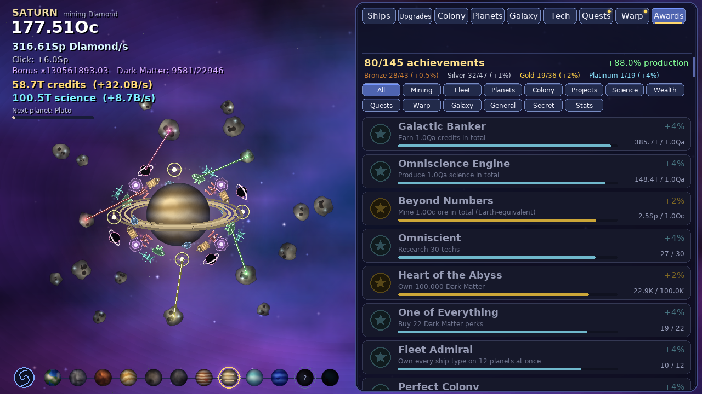

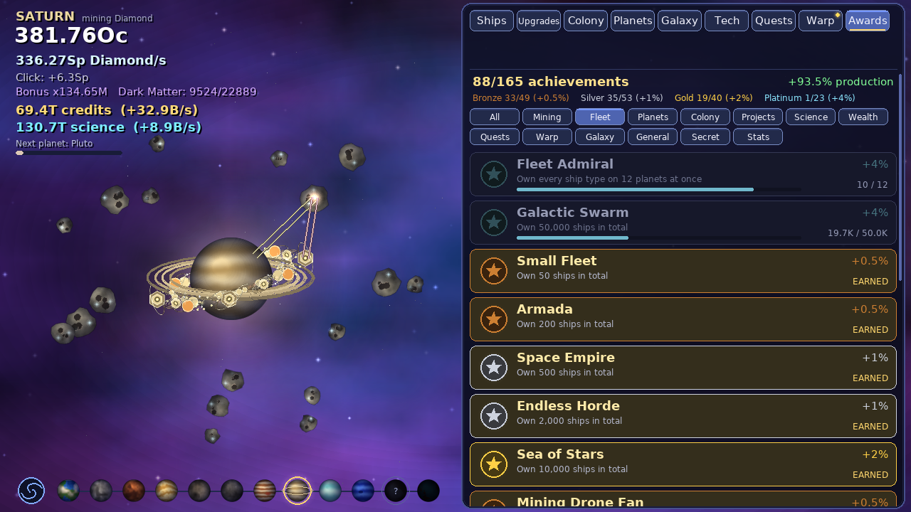

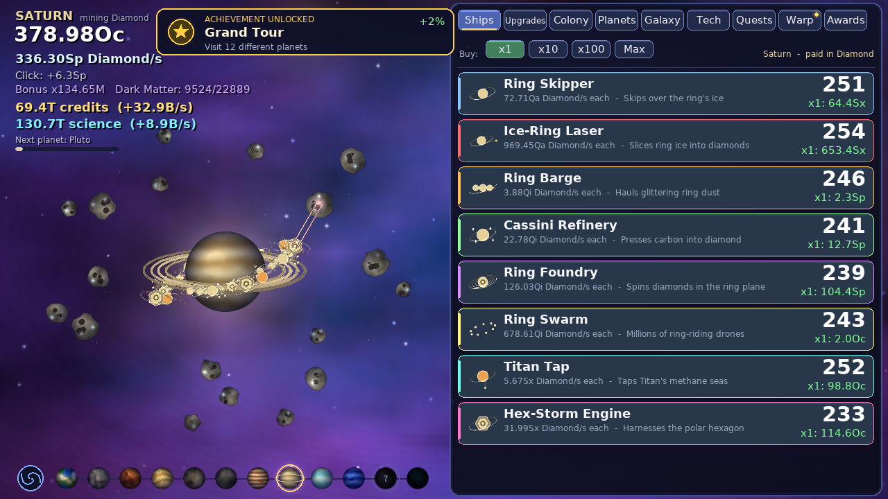

### 11. Stats and settings

The **Stats** chip in the Awards tab lists everything you have done (play time, clicks, ore mined, trips, warps, Dark Matter...) and has the settings: **sound on/off**, **volume**, **fullscreen**, **save now** and **hard reset**.

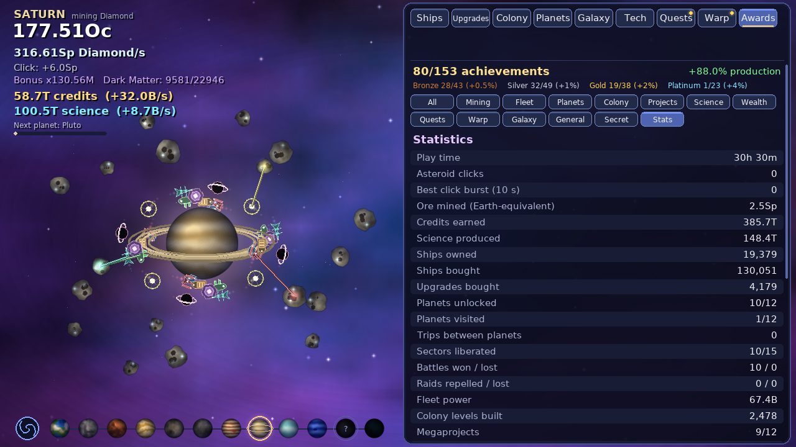

The settings are at the bottom of the page, including the **Fullscreen** button (the same as **F11**):

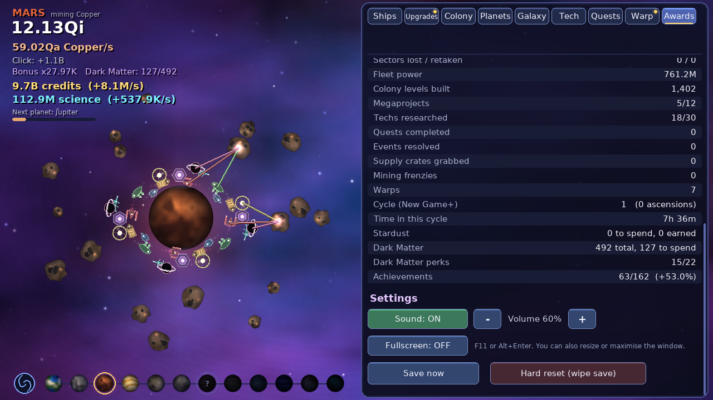

Sound effects (clicks, purchases, unlocks, crates, achievements, travel and warp) are synthesised by `sounds.py`, so there are no audio files. If there is no audio device the game just stays silent.

## Developer mode

Developer mode adds a **Dev** tab full of cheats for testing and balancing. It can **only** be switched on from the terminal - there is no in-game way to enable it:

```sh
./play.sh --dev
# or
python3 space_miner.py --dev
```

Press **F1** to jump to the Dev tab and back. A red `DEV MODE` badge shows in the corner while it is on.

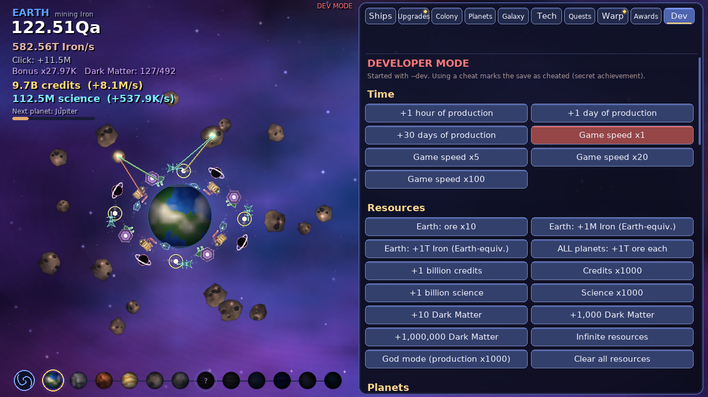

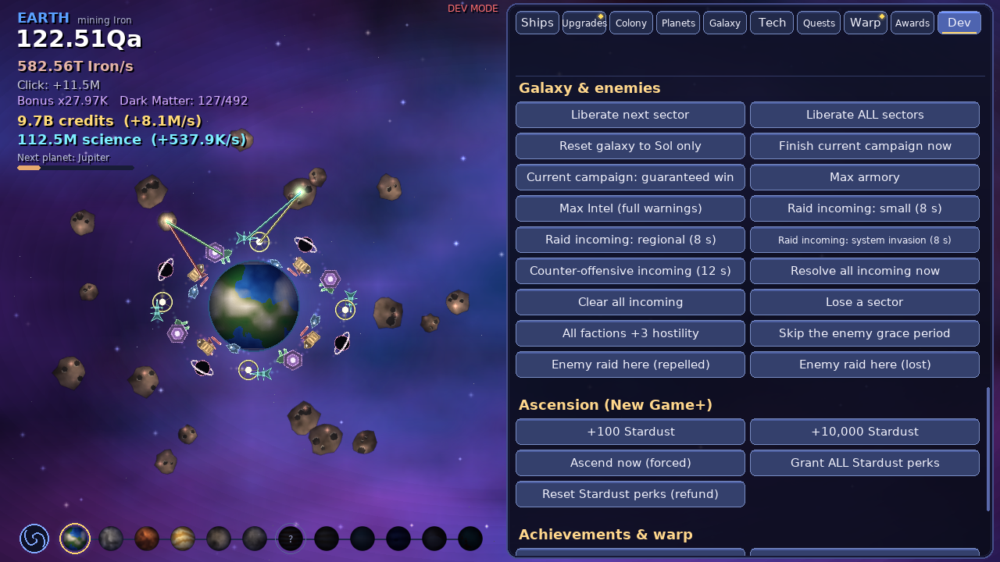

| Section | What you can do |
|---|---|
| Time | Skip +1 hour / +1 day / +30 days of production, game speed x1 / x5 / x20 / x100 |
| Resources | Add or multiply ore, credits, science and Dark Matter, **infinite resources**, **god mode** (production x1000), clear everything |
| Planets | Unlock the next planet, unlock all, relock all but Earth |
| Fleet & upgrades | Give ships to this planet or all planets, every upgrade for free |
| Colonies & megaprojects | Max every building, build one or all megaprojects |
| Tech, perks & quests | Research everything, grant or reset every Dark Matter perk, complete or reroll quests |
| Events & crates | Trigger any of the 9 random events, spawn a supply crate, start a Mining Frenzy |
| Galaxy & enemies | Liberate the next / every sector, finish or force-win a campaign, max the armory (and Intel), trigger raids you win or lose, summon a small / regional / system raid or a counter-offensive (arrives in seconds), resolve or clear all incoming attacks, lose a sector, anger every faction, skip the enemy's grace period |
| Ascension (New Game+) | Add Stardust, force an Ascension, grant or refund every Stardust perk |
| Achievements & warp | Unlock or lock every achievement, force a warp |
| Game | Save, reload from disk, wipe the save, show an FPS counter |

Using any cheat marks the save as cheated: the Stats page says so and you earn the secret *Caught in the Act* achievement. Run `python3 space_miner.py --help` for the flags.

## Late game

Later on you will be juggling a dozen planets, each with its own ore and fleet. This is what the endgame looks like on Saturn:


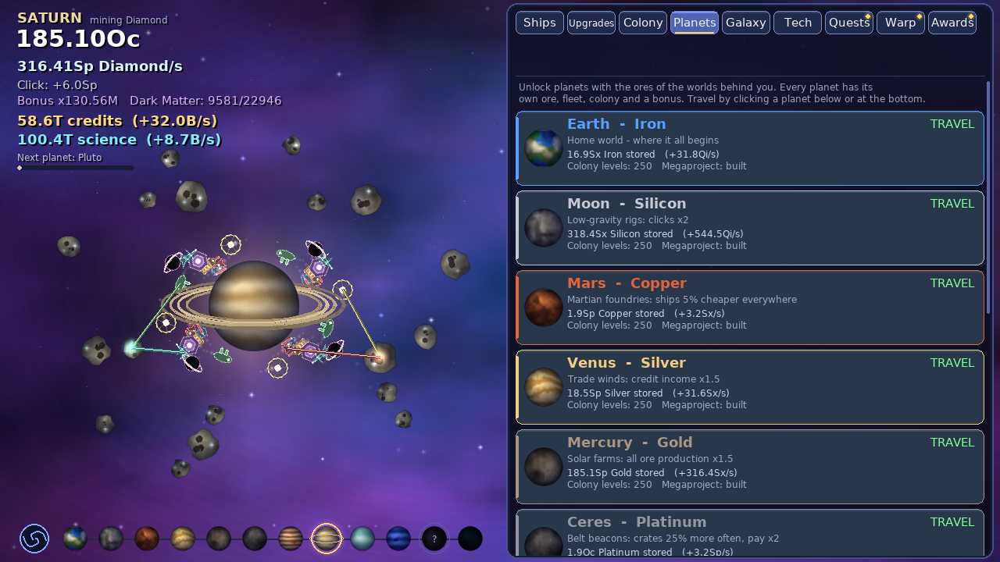

### Pacing

The pacing (planets, megaprojects and sector liberations) was tuned with a bot that plays the game headless (see below). A player who checks in every few minutes should reach roughly:

| Milestone | Roughly after |
|---|---|
| Moon | 12 minutes |
| Mars | 45 minutes |
| Venus | 1.5 - 3 hours |
| Mercury | 3 - 8 hours |
| Ceres / Jupiter | 5 - 17 hours |
| Saturn / Uranus | 15 - 33 hours |
| Neptune / Pluto | 25 - 55 hours |
| Proxima b | 45 - 70 hours |
| Every megaproject built | 50 - 100 hours |
| The final boss (Void Throne) | 65 - 90 hours |
| First Ascension, then every later cycle | after the boss; cycles of ~40 - 65 hours |

Enemy raids and counter-offensives are included in these numbers (the bot defends itself with Intel and Fortify); small raids that get through only cost a little ore. Warping a few times along the way speeds this up a lot. Playing less often just means the numbers go up while you are away.

## Tips

- Early on, click a lot - clicks are strong until your first few ships. Buy a Habitat Dome and a Research Lab on Earth as soon as you can afford them: Credits and Science unlock the tech tree.
- Don't spend everything. Unlocking the next planet needs a big stockpile of the previous planet's ore, so stop buying ships on it once the progress bar is close.
- Visit new planets right after unlocking them: clicking there bootstraps a fleet quickly, and each planet bonus helps every other planet.
- Research *Auto-Drones* and *Auto-Engineers* early and the game mostly plays itself while you travel.
- Zoom into your fronts (**Z**): sectors with red *Vulnerable* shields are the ones the enemy will take back, so Fortify them when an attack is announced - or just send the fleet out and win the fight first.
- Check the Galaxy tab every so often: a glowing dot appears on it when a campaign has a good win chance. Liberating sectors is one of the biggest production boosts in the game.
- After the boss, Ascend: spend the Stardust on the planet-starting perks and the "keep" perks first - they make every later cycle much faster.
- Put credits and science into the Armory (Weapons first) - your win chances jump quickly, and Armor makes failed campaigns cheaper.
- Build Defense Grids on planets that keep getting raided, and buy a few levels of Intel: with the target named you can Fortify it and turn a lost raid into a won one.
- Don't let your fleet fall far behind the enemy next to you: that is what makes the Threat Director aggressive. Attacking one faction over and over also makes it hit back harder.
- Open the Awards tab now and then: the nearest-to-done achievements sit at the top and every one is a permanent production bonus.
- If a dot is glowing on a tab, there is something affordable in it.

## Project layout

| File | What it is |
|---|---|
| `space_miner.py` | The game window, input and all the UI |
| `core.py` | Game rules, state, the galaxy / combat model and the achievement list. No pygame in here, so it runs headless |
| `director.py` | The Threat Director: aggression, raid and counter-offensive scheduling, Intel warnings, Fortify. No pygame either |
| `front.py` | The frontline model: where each battle line sits, status of a front, garrison and hold chances. No pygame either |
| `frontview.py` | The zoomable galaxy view: camera, mini-map, fleets and battle lines |
| `devtools.py` | The developer-mode cheats (only reachable with `--dev`) |
| `sounds.py` | Procedural sound effects |
| `gfx.py` | Procedural graphics: planets, asteroids, ships, backdrops |
| `sim.py` | A greedy bot that plays the game headless and prints a pacing timeline |
| `calibrate.py` | Searches for planet, megaproject and enemy-strength values that hit a target timeline using the bot |
| `play.sh` | Launcher that installs pygame if needed |
| `screenshots/` | Images used in this README |

### Balancing tools

```sh
python3 sim.py hours=100 interval=120        # bot checks in every 2 minutes for 100 simulated hours
python3 sim.py hours=100 interval=900 quiet=1 # only print unlocks and megaprojects
python3 sim.py hours=400 interval=120 quiet=1   # also ascends and spends Stardust: look for the ASCEND lines
python3 calibrate.py interval=120             # re-derive unlock/project/sector values (takes an hour or so)
```

The knobs live in `core.py` (`UNLOCK_LOG`, `PROJECT_LOG`, `SECTOR_LOG`, `TUNE` - including `cdiff`, `cpow` and `sdcoef` for New Game+).

### Self-test

`python3 space_miner.py --selftest` runs the game headless for a few seconds and exercises buying, unlocking, travelling, events, quests, warping and saving. It writes a few `shot_*.png` images next to the script and uses a temporary save, so it never touches your real one. Add `--dev` to also fire every developer cheat once.

## Troubleshooting

- **`ModuleNotFoundError: No module named 'pygame'`** - run `pip install pygame` (or use `./play.sh`).
- **No window appears over SSH / in a container** - the game needs a display. Run it from a desktop session.
- **The window is small / fullscreen does not work** - the game needs a desktop session with a graphics renderer for the resizable, scaled window; otherwise it falls back to a fixed 1280x720 window and the Fullscreen button is greyed out. Try running it under X11 or Wayland (not over a plain SSH session), and make sure your graphics drivers are installed.
- **Text looks off** - the game asks for DejaVu Sans, Liberation Sans or Arial and falls back to pygame's default font.
- **Reset everything** - delete `~/.space_miner_save.json`.

